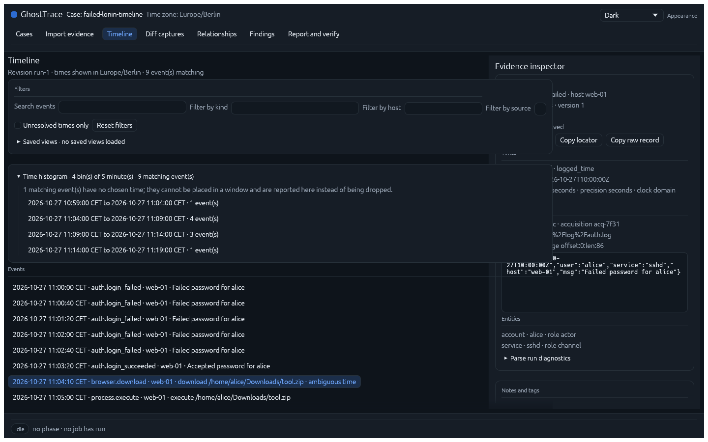
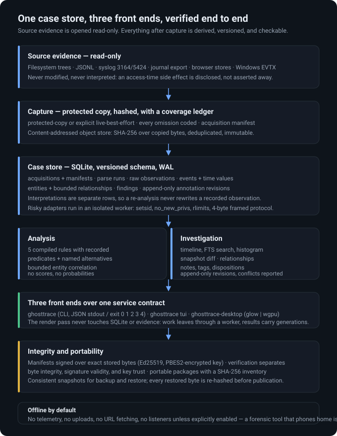
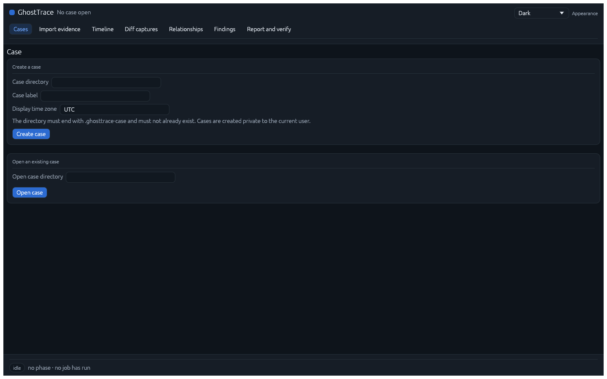
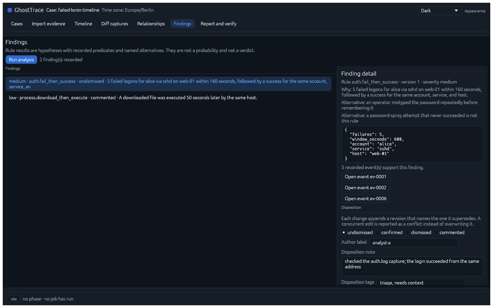
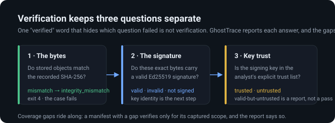

<div align="center">

# GhostTrace

**A local-first Rust forensic workbench: capture artifacts, rebuild the timeline,
and prove what you found — with the uncertainty left in.**

[](https://github.com/crastatelvin/GhostTrace/actions/workflows/ci.yml)
[](https://github.com/crastatelvin/GhostTrace/releases)
[](LICENSE-APACHE)
[](https://www.rust-lang.org/)
[](docs/storage.md)
[](crates/ghosttrace-desktop)
[](docs/releases.md)

*Everything offline. Nothing uploaded. Unknowns reported, never averaged away.*

<br/>



<sub><em>The desktop workbench on a real case — timeline, histogram, and the raw record behind the selected event.</em></sub>

</div>

---

## Status

**`1.0.0-rc.2` is published as a prerelease; Linux x86_64 is verified.** The
release pipeline ships a checksummed CLI/desktop archive with generated shell
completions, a CycloneDX SBOM, tracked samples, offline guides, a source
archive, and a tag-triggered workflow with pinned actions and build-provenance
attestation. `1.0.0` is **not** tagged: Windows/macOS native builds, live
screen-reader sessions, and terminal smoke checks remain open gates. The
candidate's tested results and known issues are in
[`docs/releases/1.0.0-rc.2.md`](docs/releases/1.0.0-rc.2.md); the platform
matrix is in [`docs/releases.md`](docs/releases.md).

| Release | Deliverable |
|---|---|
| 0.1.0-alpha.1 | Reliable folder timeline |
| 0.2.0-alpha.1 | Multi-source investigation (logs, journal, browsers, FTS) |
| 0.3.0-beta.1 | Native desktop workbench + TUI |
| 0.4.0-beta.1 | Hardened forensic package (EVTX, isolation, signatures) |
| 1.0.0 | Supported open-source release |

These identifiers describe gates, not deadlines.

## Why this exists

Most incident timelines fail in the same two places: the capture step quietly
drops what it could not read, and the reporting step quietly converts "we could
not decide" into "appeared" — or into a suspiciousness score nobody can defend.

GhostTrace is built around the opposite choices. Capture records every omission
with a stable code. Parsers report the timestamp they could not resolve instead
of inventing one. Snapshot diff keeps `unknown` as its own answer. Manifest
verification reports bytes, signature, and trust as three separate facts.
Findings are hypotheses with recorded predicates and named alternatives — there
is no "87% malicious" anywhere in the output.

It is a forensic *analysis* workbench for artifacts you are authorized to
examine — not an endpoint monitoring agent, and not a SIEM.

## What it does

| | |
|---|---|
| **Capture** | Protected copy or explicit live-best-effort of filesystem trees; SHA-256 content-addressed object store; coverage ledger codes every omission; acquisition manifest binds method, scope, and evidence IDs. |
| **Ingest** | JSONL, syslog 3164/5424, systemd journal exports, Chromium/Firefox history stores, Windows EVTX — bounded, versioned adapters with exact locators and parse diagnostics. |
| **Analyze** | Five compiled rules (fail-then-success, download-then-execute, hash-changed-metadata-equal, clock discontinuity, outside declared hours), scoped entity resolution, bounded relationship correlation, snapshot comparison that never folds "can't decide" into a verdict. |
| **Investigate** | Keyset-paged timeline, full-text search, time histogram, diff captures, relationship graph with a keyboard-reachable list equivalent, append-only notes/tags/dispositions. |
| **Prove** | Manifest signing over exact stored bytes (Ed25519, PBES2-encrypted key), verification that separates byte integrity / signature validity / key trust, redacted or unredacted reports (JSON + HTML + spreadsheet-safe CSV), portable packages with a SHA-256 inventory, consistent backup/restore. |
| **Run** | One service contract behind three front ends: a scripted CLI, a terminal UI, and a native desktop app (egui/eframe, glow or wgpu). |

## Architecture



| Crate | Role |
|---|---|
| `ghosttrace-core` | Case store, capture, adapters, analysis, integrity — everything a front end can call. Pure library; no UI code. |
| `ghosttrace-cli` | Scripted CLI (`ghosttrace …`), terminal UI (`ghosttrace tui`), and the hidden isolated parser worker (`ghosttrace worker --protocol 1`). |
| `ghosttrace-desktop` | Native desktop shell on the same state machine and worker boundaries; render callbacks never touch SQLite or evidence. |
| `xtask` | Local check battery, scale harness, fixtures, packaging, SBOM. |

Front ends talk to one service contract through worker threads; the render pass
only reads pure state. Results carry generations, so a stale page is dropped
rather than silently shown.

## Quickstart

```bash
rustup show                                          # pinned 1.99.1 from rust-toolchain.toml
cargo build --workspace --locked --release
export PATH="$PWD/target/release:$PATH"

ghosttrace case create --case /cases/demo.ghosttrace-case --label demo
ghosttrace scan       --case /cases/demo.ghosttrace-case --source /evidence/export
ghosttrace import     --case /cases/demo.ghosttrace-case --path logs/app.jsonl \
  --format jsonl --time-field ts --kind-field kind --host-field host --message-field msg
ghosttrace timeline   --case /cases/demo.ghosttrace-case --last 24h
ghosttrace analyze    --case /cases/demo.ghosttrace-case
ghosttrace report     --case /cases/demo.ghosttrace-case --output /cases/reports --csv
ghosttrace annotate   --case /cases/demo.ghosttrace-case record --finding fnd-… \
  --author analyst-a --text "checked the source log" --disposition confirmed
```

Exit codes are the contract: `0` success, `3` partial (diagnostics recorded or
cancelled), `2` invalid usage, `1` failed, `4` verification failure. Success
prints one JSON object on stdout; failures print `{error, message}` on stderr.

## Screenshots

<table>
<tr>
<td width="50%"></td>
<td width="50%"></td>
</tr>
</table>

<p align="center"><em>Case workflow (dark) · Findings with recorded predicates, named alternatives, and append-only dispositions</em></p>

## Verification is three questions, not one word



## Forensics over features

- **Source evidence is opened read-only.** Analysis operates on captured copies; every captured object is content-addressed and SHA-256 verified.
- **Capture is best effort only when you say it is.** `protected-copy` is the default; `live-best-effort` prints its warning at the point of choice, and reading files may affect access-time metadata — disclosed, not asserted absent.
- **Uncertainty is first-class.** Unresolved and ambiguous timestamps, missing hashes, incomplete traversals, and parser failures all surface as recorded states. An incomplete capture verifies *as partial*, not as clean.
- **No scores, no verdicts.** Findings carry predicates, supporting events, plausible alternatives, and an analyst's disposition — never a probability.
- **Offline by default.** No telemetry, no uploads, no URL fetching from artifacts, no network listeners unless explicitly enabled. Risky adapters parse inside an isolated worker (`setsid`, `no_new_privs`, rlimits).
- **Annotations are append-only.** A note, tag, or disposition records the revision it supersedes; a concurrent edit is reported as a conflict, not overwritten.

## Scale and performance (measured, on this host)

| Metric | Result |
|---|---|
| 1M-event JSONL import | 5,150 events/s on tmpfs · 2,019 events/s on ext4 (durable commits) |
| 10-GiB / 100,000-file capture corpus | ran in full — see [`docs/performance.md`](docs/performance.md) |
| Capture throughput | 52.2 MiB/s and 524 files/s on 100k files (ext4) |
| Peak RSS, capture + 1M ingest | 439 MiB (target ≤ 512 MiB) |
| Timeline first page, warm p95 | 0.71 ms (tmpfs) · 3.64 ms (ext4), 1M events |
| Histogram over 1M events | 376 ms (tmpfs) · 602 ms (ext4), computed off the render thread |

Numbers are one host, one kernel, one filesystem — regression baselines, not
promises. The one target that is not met is stated and narrowed, not quietly
dropped: [`docs/performance.md`](docs/performance.md).

## Documentation

| Guide | Contents |
|---|---|
| [Installation](docs/installation.md) | build, release archive, first case, upgrades, licensing, custody |
| [Quickstart](docs/quickstart.md) | prerequisites per platform, checks, desktop build |
| [CLI](docs/cli.md) | every command, output contract, exit codes, TUI keys |
| [Desktop](docs/gui-guide.md) | screens, keyboard, accessibility, appearance system |
| [Reports](docs/reports.md) | manifests, signatures, redaction, HTML/CSV exports |
| [Timestamps](docs/timestamps.md) | statuses, zones, precision versus accuracy |
| [Formats](docs/formats.md) | mappings, bounds, rule parameters, signing formats |
| [Storage](docs/storage.md) | schema, revisions, jobs, recovery |
| [Architecture](docs/architecture.md) | component map and worker boundaries |
| [Threat model](docs/threat-model.md) | trust boundaries and claims not made |
| [Performance](docs/performance.md) | measured baselines, the narrowed ingest target |
| [Testing](docs/testing.md) | fuzz, recovery, dependency, platform matrix |
| [Limitations](docs/limitations.md) | unsupported formats, custody, platform, accessibility |
| [Troubleshooting](docs/troubleshooting.md) | permissions, WAL, schema, time, signatures, backup |
| [Releases](docs/releases.md) | platform matrix, verification of published artifacts |
| [Candidate notes](docs/releases/1.0.0-rc.2.md) | the 1.0.0-rc.2 tested results and known issues |
| [Samples](samples/README.md) | two tracked synthetic investigations |

## Platform support

| Platform | Status |
|---|---|
| Linux x86_64 | **Verified** — build, CLI, TUI, desktop (glow and wgpu), release pipeline |
| Windows / macOS | Code paths exist; native builds and screen-reader sessions are **open gates** — do not read a compile as support |

Accessibility: every control is addressable by name and keyboard in the
AccessKit tree, with a list equivalent for the relationship graph. Live
NVDA/VoiceOver/Orca sessions remain an open release gate, not a completed claim.

## Contributing

See [CONTRIBUTING.md](CONTRIBUTING.md). Security issues: report privately per
[SECURITY.md](SECURITY.md) — and never upload real evidence anywhere, including
to this project.

## License

Dual-licensed under [Apache-2.0](LICENSE-APACHE) or [MIT](LICENSE-MIT), at your
option. Bundled third-party material carries its own notices
([THIRD_PARTY_NOTICES.md](THIRD_PARTY_NOTICES.md)).

---

<sub>GhostTrace verifies artifacts; it does not judge people. Every output
distinguishes observed fact from interpretation, and every gap is a reported
gap.</sub>
