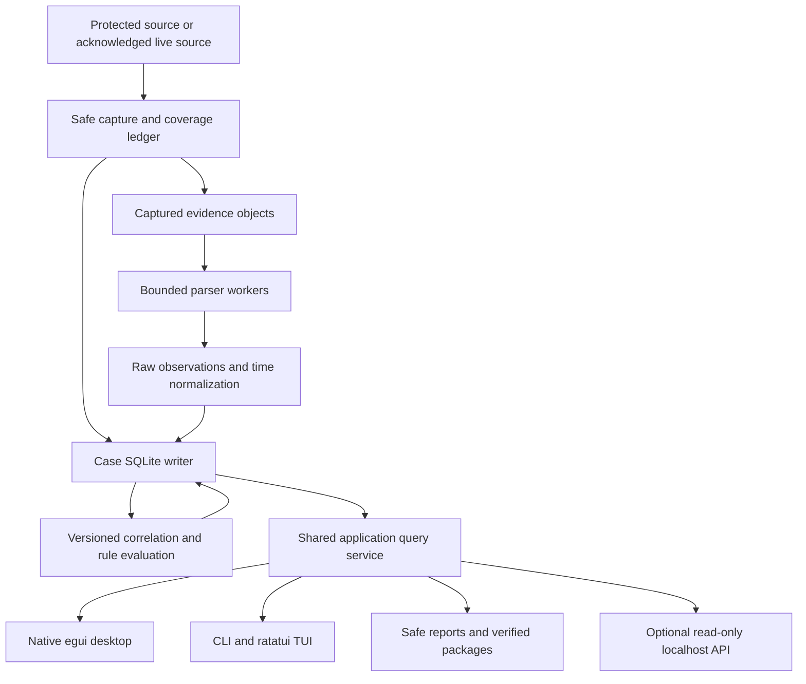

# GhostTrace — Complete Design and Implementation Plan

> **For agentic workers:** During implementation, use `superpowers:subagent-driven-development` or `superpowers:executing-plans` task by task. This document is a plan only. Its commands, file trees, interfaces, and test names describe future work; none has been implemented by creating this document. Steps use checkbox syntax for tracking.

**Goal:** Build a free, open-source, local-first Rust forensic workbench that reconstructs searchable timelines from captured artifacts, shows the evidence and uncertainty behind each claim, compares file snapshots, and produces verifiable investigation packages.

**Architecture:** A modular Rust core owns acquisition, parsing, time normalization, SQLite storage, querying, correlation, integrity, and reporting. A native Rust desktop application and a CLI with an optional TUI call the same application service. A later, read-only Axum localhost API exposes those query services without becoming necessary for desktop operation.

**Tech stack:** Rust stable, egui/eframe, rusqlite with bundled SQLite, Tokio, serde, chrono/chrono-tz, sha2, clap, ratatui/crossterm, tracing, and Ed25519 signing in the integrity phase. No paid backend, cloud account, JavaScript application, Node build pipeline, or proprietary forensic SDK is required.

**Spec:** Sections 1–15 of this document are the design specification. Sections 16–22 are its implementation tasks, verification gates, and delivery checklist.

**Plan date:** 23 October 2026, Asia/Kolkata. Research was performed against public project repositories, official documentation, and crates.io on this date. Dependency versions below are researched starting candidates, not a claim that the complete dependency set has been built together.

**Project root:** `/home/maya/Projects/GhostTrace`.

## Global constraints

- All first-party application code, fixture generation, and test tooling are Rust; Markdown, TOML, SQL migrations, workflow YAML, and static report HTML/CSS are supporting formats.
- The required GUI is a native Rust desktop GUI, as selected by the project owner.
- The application works offline and never uploads evidence, fetches browser-history URLs, or sends telemetry.
- Source evidence is opened without write access. Analysis operates on captured copies. Reading a live source can still update access times or cause host activity.
- Captured bytes and raw observations are preserved; interpretations, annotations, and clock corrections are separately versioned.
- A SHA-256 match establishes equality of captured bytes. A signature establishes who signed particular bytes subject to key trust. Neither proves historical truth or legal admissibility.
- No unknown timestamp, missing hash, incomplete traversal, or parser failure is silently converted into a successful result.
- One process owns case writes at a time; all front ends use the same writer and query contracts.
- The initial release has no arbitrary code plugins, automatic evidence execution, remote server, credential extraction, or destructive remediation.
- Rust toolchain candidate: `1.99.1`, edition `2024`; declared initial MSRV candidate: `1.99.1`. Phase 0 must prove the selected dependency set and platform builds before these become published support claims.
- Commit `Cargo.lock`; use `--locked` in CI and releases. Never use floating Git dependencies in a release.
- Ship under `Apache-2.0 OR MIT`, with explicit licenses for fonts, fixtures, and bundled third-party materials.
- Do not initialize Git, commit, create a GitHub repository, push, or implement software as part of this planning-only request.

## 1. Product purpose and success criteria

GhostTrace helps an investigator answer four questions: what was observed, when might it have happened, which records support that interpretation, and what remains unknown? Its central interface is a timeline with a linked evidence inspector. It is a forensic analysis tool for artifacts the user is authorized to examine, rather than an endpoint monitoring agent.

The core workflow is:

1. Create a local case and record its context.
2. Import a protected evidence directory or explicitly acknowledge a best-effort live acquisition.
3. Capture files, native paths, metadata, coverage results, and SHA-256 digests.
4. Parse supported artifacts into raw observations and normalized events.
5. Review time assumptions, coverage, integrity, and parser diagnostics.
6. Search the timeline; inspect sources; compare snapshots; inspect explainable relationships and findings.
7. Add notes, tags, bookmarks, and finding dispositions.
8. Export a safe report and independently verifiable evidence/analysis manifests.
9. Reopen the case offline and reproduce the analysis from recorded parser/rule versions.

The first public alpha must scan, hash, persist, query, verify, compare, and export a real folder without modifying its contents. The desktop beta must complete an investigation without terminal commands. Version 1.0 must meet the supported-artifact, provenance, safety, accessibility, recovery, packaging, and documentation gates in this plan.

### What professional quality means here

| Property | Observable requirement |
|---|---|
| Correctness | Raw source locators, exact times/assumptions, coverage-aware diffs, deterministic rule outputs |
| Usability | Case wizard, fast filtered timeline, evidence details, actionable errors, cancel/recovery, keyboard navigation |
| Privacy | No application network access by default; private case permissions; no evidence in diagnostic logs |
| Integrity | Full SHA-256 capture, verification, exact manifest signatures, export digests, explicit trust status |
| Maintainability | Shared core, fixed adapter contracts, migrations, compatibility policy, reviewable commits |
| Performance | Streaming imports, bounded queues, indexed pagination, measured reference benchmarks |
| Reliability | Transactional batches, staged objects, crash recovery, atomic report publication |
| Accessibility | Named controls, focus order, accessible list equivalent to every graph, OS screen-reader verification |
| Openness | Free dependencies, reproducible datasets, documented limits, contributor and release processes |

## 2. Scope, release ladder, and relevant additions

### Required capabilities by release

| Release | Deliverable | Included capabilities |
|---|---|---|
| `0.1.0-alpha.1` | Reliable folder timeline | Case management, safe acquisition, SHA-256, metadata events, SQLite, scoped diff, JSON/HTML export, CLI |
| `0.2.0-alpha.1` | Multi-source investigation | JSONL, explicit legacy/RFC syslog handling, journal exports, Chromium/Firefox captured databases, time review, FTS |
| `0.3.0-beta.1` | Native desktop workbench | Complete GUI workflow, virtualized timeline, evidence inspector, notes, graph/list relationships, explainable rules, TUI |
| `0.4.0-beta.1` | Hardened forensic package | Captured EVTX, parser worker isolation, signed manifests, verified case backup/restore, migration compatibility |
| `1.0.0-rc.1` → `1.0.0` | Supported open-source release | Passed corpus/security/accessibility/recovery gates, binaries, offline instructions, sample investigations, published limits |
| `1.1.0` | Optional local integration | Read-only localhost Axum API, OpenAPI specification, Rust HTTP client example; existing desktop remains self-contained |

Release identifiers describe intended gates, not deadlines or existing artifacts. A failed gate blocks promotion even when all checklist boxes for implementation are marked.

### Extra features that directly improve investigations

- Evidence coverage dashboard: counts and examples for captured, excluded, inaccessible, unstable, missing, and unsupported items.
- Time-assumption review: unresolved timestamps, ambiguous local times, host/boot clock domains, and recorded investigator adjustments.
- Saved searches, bookmarks, tags, case notes, and a review queue for findings.
- Hash-based duplicate-content relationships without merging original paths or provenance.
- Bounded evidence relationship exploration with an accessible list showing the same edges.
- Source-specific artifact summaries and drill-down to exact records.
- Redacted report projections with an explicit redaction ledger.
- Resume/recovery for interrupted jobs, consistent case backup/restore, and schema migration previews.
- Dataset generators, adversarial fixtures, benchmarks, and two reproducible sample investigations.
- Portable distributions, offline source-build instructions, and optional localhost integrations.

### Separate future capabilities, outside version 1.0

Raw disk-image filesystems, NTFS MFT/USN parsing, deleted-record carving, memory dumps, packet captures, automatic VSS/LVM/APFS acquisition, native `.journal` decoding, macOS unified logs, email/chat adapters, YARA scanning, and Sigma import each need their own format, safety, licensing, and validation design. Browser secret extraction, live surveillance, distributed cases, cloud synchronization, and AI attribution are excluded from this roadmap.

These boundaries keep the promised product usable: complete the common artifact workflow before claiming broad forensic acquisition coverage.

## 3. Architecture options and decision

| Approach | Advantages | Costs/limitations | Decision |
|---|---|---|---|
| egui/eframe native desktop + shared core | Rust UI and backend; mature tool-oriented controls; custom timeline drawing; no web server required; AccessKit integration | Custom widgets need accessibility work; immediate-mode rendering must avoid per-frame database work; graphics/native dependencies | **Selected** |
| iced native desktop + shared core | Rust throughout; explicit application state/message model | Current upstream describes experimentation; verify stable accessibility before depending on it; more UI integration risk for this roadmap | Reserve alternative if Phase 0 disproves egui suitability |
| Rust web UI with Leptos/Dioxus + desktop webview | Web styling ecosystem; potential browser client reuse | Browser/webview runtime, web asset pipeline, IPC/security complexity; changes the requested native GUI approach | Do not build for version 1.0 |

Use one workspace and one core library initially. Separate libraries by actual maintenance boundaries only when justified. SQLite replaces separate search and graph servers: FTS5 handles text search, relational edge tables handle relationships, and bounded queries handle neighborhoods.



### Dependency decisions and researched candidates

Versions were read from crates.io metadata on the plan date. Phase 0 must resolve and compile them, inspect feature graphs, and commit the resulting lockfile. Do not assume a version table proves API compatibility.

| Purpose | Choice / initial candidate | Reason and boundary |
|---|---|---|
| Toolchain | Rust `1.99.1` | Published stable manifest/release checked; exact toolchain pin |
| GUI | `eframe`, `egui`, `egui_extras` `0.37.0` | Keep versions aligned; AccessKit enabled; choose one renderer after pilot |
| GUI testing | `egui_kittest` `0.37.0` | Query accessible roles/names, not brittle pixel positions |
| Database | `rusqlite` `0.40.2`, `bundled` | Bundled SQLite, fixed schema, FTS5; no SQLx or ORM |
| Jobs/runtime | `tokio` `1.54.1` | Bounded async coordination; blocking capture/parsing on controlled workers |
| Serialization | `serde` `1.0.229`, `serde_json` `1.0.154` | Versioned JSON/JSONL; strict manifest decoding; native paths explicitly encoded |
| CSV reports | `csv` `1.4.0` | Correct streaming CSV quoting plus separate spreadsheet-safety projection |
| Time | `chrono` `0.4.45`, `chrono-tz` `0.10.4` | Calendar formatting and DST ambiguity; exact raw/normalized integers in the domain |
| Hashing | `sha2` `0.11.1` | SHA-256 interoperability; streaming full-content hashing |
| CLI | `clap` `4.6.7` | Help, validation, shell completion generation |
| TUI | `ratatui` `0.30.2`, `crossterm` `0.29.0` | Same query service, restoration guard, safe terminal output |
| EVTX | `evtx` `0.13.0` | Captured file parser; provider message resources not assumed available |
| Signatures | `ed25519-dalek` `3.0.0` | Exact-byte manifest signing; verify strictly; no custom cryptography |
| Key storage | compatible `pkcs8` encryption + `rpassword` + `zeroize` | P9.1 verifies encrypted-key feature/API support; plaintext secret keys are not the shipped default |
| URLs | `url` `2.5.8` | Structured entities; no fetching; preserve raw URL too |
| Config | `toml` stable release resolved at Phase 0 | Small case/rule configs, versioned schema, unknown-field diagnostics |
| Diagnostics | `tracing` `0.1.44` | Structured operational logging with evidence redaction |
| IDs | `uuid` `1.28.0` | Opaque case/object/run IDs; deterministic source locator identity stored separately |
| Platform safety | `nix` / `windows` where needed | Descriptor/handle traversal and source containment; narrow reviewed platform modules |
| Tests | `tempfile`, `proptest`, `criterion` | Real temporary cases, time/path properties, performance measurements |
| Optional API | `axum` `0.8.9` | Later read-only local endpoints, explicit opt-in |

Use the smallest verified feature sets. Do not add Rayon as well as a Tokio worker pool until measurement proves a need. Do not add a chart or graph crate until the bounded timeline/relationship views exceed egui primitives. Use standard controls for path entry; a native file dialog is a usability enhancement selected and tested in the GUI phase, not a dependency on day one.

For rusqlite select `bundled`, `backup`, `hooks`, and `limits` as tasks require them, instead of `bundled-full`; do not enable/call `load_extension`. Start FTS5 with documented `unicode61` token semantics. It provides word/phrase search, not arbitrary substring matching. Any later trigram index needs a measured storage/query decision and compatibility tests.

“Rust throughout” refers to first-party application code. `rusqlite` embeds C SQLite; graphics drivers, OS frameworks, and platform libraries are native dependencies. Replacing SQLite with an unproven Rust-only database would undermine the product's storage requirements.

### Free use and actual costs

The source, binaries, core dependencies, fixture generator, and offline workflow are free to use. Public GitHub repositories can use standard hosted Actions runners under GitHub's public-repository policy. Larger runners, some storage/usage, private repositories, and future policy changes may carry costs. Hardware for Windows/macOS verification remains necessary. Apple Developer ID/notarization and commercially trusted Windows signing may cost money; provide unsigned free builds with honest installation instructions rather than promising universally trusted zero-cost installers. No subscription is needed to operate GhostTrace.

## 4. Proposed repository layout

This tree is a design, not a generated scaffold. Introduce each file only when its task needs it.

```text
GhostTrace/
├── Cargo.toml                     workspace, shared dependency versions
├── Cargo.lock                     committed application dependency graph
├── rust-toolchain.toml            exact toolchain and rustfmt/clippy components
├── LICENSE-APACHE / LICENSE-MIT
├── README.md / CHANGELOG.md / CONTRIBUTING.md / SECURITY.md
├── CODE_OF_CONDUCT.md / SUPPORT.md / THIRD_PARTY_NOTICES.md
├── .gitignore / .gitattributes / deny.toml
├── crates/
│   ├── ghosttrace-core/
│   │   ├── Cargo.toml
│   │   ├── src/
│   │   │   ├── lib.rs / error.rs / service.rs / jobs.rs
│   │   │   ├── domain/{case,evidence,event,time,path,query,finding}.rs
│   │   │   ├── capture/{mod,walker,copy,coverage,unix,windows}.rs
│   │   │   ├── ingest/{mod,jsonl,syslog,journal,browser,evtx}.rs
│   │   │   ├── storage/{mod,writer,read,search,migrate,backup}.rs
│   │   │   ├── analysis/{mod,diff,entities,correlate,rules}.rs
│   │   │   ├── integrity/{mod,hash,manifest,signature,keys}.rs
│   │   │   └── reports/{mod,json,html,csv,redact,package}.rs
│   │   ├── migrations/{0001_case,0002_search,0003_analysis}.sql
│   │   ├── tests/                 contract/integration tests named by tasks
│   │   └── benches/{capture,ingest,query,correlation}.rs
│   ├── ghosttrace-cli/
│   │   ├── src/{main,commands,output,worker}.rs
│   │   └── src/tui/{mod,state,views,input}.rs
│   ├── ghosttrace-desktop/
│   │   ├── src/{main,app,state,commands}.rs
│   │   └── src/views/{cases,import,timeline,evidence,diff,relations,findings,report}.rs
│   └── ghosttrace-server/         added only in optional API phase
│       └── src/{main,auth,routes}.rs
├── xtask/                         Rust fixture/check/package helper
│   └── src/{main,fixtures,check,package}.rs
├── tests/fixtures/
│   ├── catalog.toml / LICENSE.md
│   ├── small-case/ / time-edges/ / path-edges/ / sqlite-wal/
│   ├── syslog/ / journal/ / evtx/ / hostile-inputs/
│   └── expected/                 versioned ground-truth projections
├── examples/investigations/       sample narratives and expected result ledgers
├── rules/                        documented built-in rule metadata
├── assets/                       licensed icons/fonts, no copied product branding
├── docs/
│   ├── plans/2026-10-23-ghosttrace-master-plan.md
│   ├── architecture.md / evidence-model.md / timestamps.md / formats.md
│   ├── quickstart.md / gui-guide.md / cli.md / verification.md
│   ├── threat-model.md / testing.md / performance.md / releases.md
│   └── adr/                      short accepted decision records
└── .github/
    ├── workflows/{ci,security,release}.yml
    ├── ISSUE_TEMPLATE/ / PULL_REQUEST_TEMPLATE.md / CODEOWNERS
    └── dependabot.yml
```

Do not publish local case stores, captured evidence, source-machine paths, private keys, debug dumps, or generated corpora with personal data. `.gitignore` blocks `target/`, `*.ghosttrace-case/`, local case directories, secret keys, and runtime packages; small licensed fixtures are deliberately tracked under `tests/fixtures/`.

## 5. Data model and evidence semantics

### Records and ownership

| Record | Essential fields | Meaning |
|---|---|---|
| Case | ID, label, schema version, creation instant, display timezone, description | Investigator workspace, not proof of source identity |
| Acquisition | ID, case ID, claimed host/volume, roots/exclusions, link policy, method, start/end, tool version, state | What was attempted and under which collection conditions |
| Coverage item | acquisition ID, relative path/subtree, status, error code, attempts, scope | Captured, excluded, inaccessible, unstable, vanished, unsupported, or unobserved |
| Evidence object | ID, acquisition ID, raw path, type, byte length, digest status, SHA-256, object location | Captured bytes or a captured non-file observation |
| File observation | ID, evidence ID, native identity, link target/count, size, raw timestamp fields, observation time | Filesystem facts observed during acquisition |
| Parse run | ID, acquisition ID, parser ID/version, config digest, state, counts, diagnostics | Versioned artifact interpretation |
| Raw observation | ID, parse run, evidence ID, record locator, raw values, diagnostics | What a parser actually extracted |
| Event | ID, parse run/revision, event kind, summary, host/domain claims, observation references | Normalized interpretation with retrievable provenance |
| Event time | event ID, semantic field, raw value/epoch, normalized candidates, resolution, assumptions, clock domain | Exact known values plus uncertainty |
| Entity | ID, kind, scoped identity, raw/display forms | Account/session/process/file/URL/network endpoint without premature identity merges |
| Relationship | source/target, kind, rule/version, supporting observation IDs, strength basis | Observed relation or derived candidate, always labeled |
| Analysis run | ID, input parse runs, rules/version, config digest, time adjustments, state | Reproducible set of correlations/findings |
| Finding | ID, analysis run, rule/version, event IDs, predicates, severity, rationale, alternatives | Investigative lead, not an event or a guilt conclusion |
| Annotation revision | target ID, author label, timestamp, previous revision, text/tags/disposition | Analyst opinion/history, separately mutable |
| Export run | ID, input revision/filter, redaction profile, files/digests, state, manifest IDs | Reproducible report projection |

Use application-generated opaque IDs. An idempotency key for a raw record is the acquisition ID + evidence object ID + parser version/config + exact record locator. Re-importing the same already-completed artifact in the same run does not duplicate it. Importing the same bytes as a new acquisition preserves a distinct provenance chain. Content deduplication may reuse object bytes, never acquisition identities.

### Source locators

- Text/JSONL: original object ID plus byte offset, byte length, line number when meaningful, and record digest.
- Journal export: object ID plus record byte range, cursor if present, boot ID, and retained repeated fields.
- Browser SQLite: captured object/package ID, table, primary key/visit ID, schema fingerprint, query adapter version; disclose that row references are logical rather than raw byte ranges.
- EVTX: object ID, chunk/record location where parser exposes it, channel/provider, event record ID; record IDs are scoped to their source.
- Filesystem: acquisition path entry and handle-based metadata observation, with observation interval and object identity where available.

When a parser cannot supply a byte locator, retain the strongest supported logical locator and describe that limitation. Never invent offsets.

### Raw and derived information

Raw evidence objects are immutable by application convention and checked by hashes. New parsing, corrected timezone assumptions, changed rules, or edited notes produce new runs/revisions. Existing results remain available for comparison and old report reproduction. The SQLite database is an analysis store that the local owner can edit; an audit hash chain can help detect some changes but is not an externally secured ledger. Signed exports provide a portable verification boundary.

## 6. Timestamps, paths, and file snapshots

### Time representation

Use exact signed Unix seconds plus integer nanoseconds for normalized instants. Preserve original integer/string value, epoch, unit, source field, semantic meaning, resolution, offset/timezone, clock domain, and parser assumptions. JSON exports encode values beyond safe interoperable integer precision as decimal strings. Do not store everything as one signed nanosecond integer: its date range is too narrow for some forensic inputs.

An `EventTime` has status `resolved`, `ambiguous`, `unresolved`, or `invalid`, with zero or more candidate instants. A missing time is not epoch zero. Declared timestamp resolution is not a measured accuracy bound. Known clock adjustments are separate analysis inputs with investigator attribution and rationale.

- Unix `mtime` means content modification; `ctime` means status/metadata change; birth time is optional; access time can be deferred, disabled, or affected by collection.
- Windows FILETIME uses 100 ns units since 1601. Filesystem behavior and delayed access updates affect interpretation.
- Chromium commonly uses microseconds since 1601; Firefox PRTime uses microseconds since 1970. Preserve schema-specific exceptions.
- EVTX `TimeCreated` denotes logging time; payload occurrence time is a separate field.
- Journal realtime and monotonic times are separate. Monotonic ordering only applies within the same boot clock domain.
- Legacy syslog may omit year and timezone. Require explicit source assumptions; do not use the analyst computer's timezone silently.
- A DST overlap retains both UTC candidates. A nonexistent local time remains unresolved unless a recorded correction resolves it.
- Stable display sorting uses chosen candidate/time status, source ID, and record identity; equal/overlapping uncertain times do not establish a proven order.

The GUI defaults to UTC for case display until the investigator chooses another timezone. It always shows the chosen zone and an uncertainty badge. The workstation locale controls presentation preferences, not source-time interpretation. `timeline --last 24h` anchors to the latest resolved event in the selected case, displays that anchor, and accepts `--until` for an explicit instant.

### Native path representation

Store Unix path bytes or Windows UTF-16 code units with a platform/encoding tag. Keep a reversible encoded form for interchange and an escaped display form for humans. Lossy string conversion, Unicode normalization, case folding, and path canonicalization must not determine identity.

Separate an observed path entry from native object identity. Scope Unix device/inode and Windows file ID by acquisition volume/host. Hardlinks create multiple path observations; identifier reuse makes cross-snapshot continuity a candidate. Capture symlink targets and reparse-point metadata without following them by default. Do not hash FIFOs, sockets, or device nodes as ordinary files.

### Safe capture

Open source objects using containment-aware, no-follow descriptor/handle operations. Use root-relative traversal on Unix and reparse-aware handle checks on Windows. Validate object identity after opening. Stream bytes once into private staging while hashing those exact captured bytes. Publish the object only after successful write, sync, metadata recheck, and coverage recording. Handle the case store being inside the selected evidence root by rejecting the overlapping layout before acquisition.

Pre/post metadata checks detect common concurrent changes; they cannot prove an atomic snapshot against an adversary. Mark live acquisition as best effort. Permission-dependent no-atime support is an optimization with explicit fallback, not a guarantee. Stronger evidence acquisition remains an external protected-copy/snapshot workflow.

### Snapshot diff semantics

First compare host/volume/root mappings, exclusions, link policies, and coverage. Return these categories:

| Result | Required evidence |
|---|---|
| Appeared in captured scope | Comparable scope, absent earlier, captured later |
| No longer present in captured scope | Complete relevant enumeration in both captures; present earlier, absent later |
| Content changed | Two successful full digests differ |
| Captured content equal | Two successful full digests match |
| Metadata changed | Comparable metadata differs; content result remains separate |
| Rename/move candidate | Scoped native identity continuity with changed path, with hardlink/ID-reuse caveat |
| Duplicate-content relation | Equal full hashes across objects; no automatic copy/move claim |
| Unknown comparison | Missing hashes, coverage gaps, scope mismatch, unstable capture, or unsupported identity |

Two snapshots do not reveal intermediate changes or recover deleted files. Never infer equality from size/mtime alone, or deletion from an inaccessible subtree.

## 7. Ingestion formats and normalization contracts

### Supported adapter matrix

| Adapter | Input | Version 1.0 scope | Explicit limits |
|---|---|---|---|
| Filesystem | Captured directory entries/content | Metadata timestamps, identities, SHA-256, coverage | Not a raw filesystem image parser |
| Generic JSONL | UTF-8 record-per-line structured logs | Documented schema; configured timestamp/event/host fields; raw record retained | Bounded mapping, no executable expressions |
| Syslog | RFC5424 and selected RFC3164 text | Header fields, raw message, known auth/system patterns | Missing year/zone requires assumption; vendor format diagnostics |
| Journal export | systemd binary-safe export stream | Repeated/binary fields, cursor, boot ID, realtime/monotonic | Native `.journal` files need external export or later adapter |
| Chromium family | Captured History database package | Recognized visits/URLs/transitions and downloads for tested schema fingerprints | Download path/time/URL-chain columns vary; unsupported fields explicit; profile/sync uncertainty disclosed |
| Firefox | Captured `places.sqlite` package | Recognized visits/places/referrers for tested fingerprints | Schema drift rejected with actionable details |
| Windows EVTX | Captured `.evtx` files | Structured system/payload fields, record locators, selected auth/process events | Provider text may require unavailable resources; no Event ID-only universal interpretation |

Auto-detection checks signatures/schema, not filename alone. A manual adapter override is recorded. Each adapter emits a format/version compatibility result before bulk processing. Unsupported tables/provider versions remain raw evidence and receive diagnostics, not fabricated events.

### Browser SQLite consistency

Capture the database and available WAL/journal sidecars as one declared package. Preserve their original bytes and acquisition status. Parse only private copies. A copied main DB without its committed WAL contents can be incomplete; warn/reject depending on package validation. Do not set `immutable=1` on a changing source. A validated logical backup of a live DB is a separate derived acquisition, useful for consistent rows but different from preserving original physical pages/deleted records. The first browser workflow favors externally captured stable packages over live profile acquisition.

Use fixed read-only queries and schema fingerprints. Enable defensive mode and `trusted_schema=OFF` where supported; disable extension loading and reject unexpected views/virtual tables in adapter inputs. Set SQLite size/SQL/column limits and progress deadlines. Current patched SQLite is required. Do not execute SQL provided in imported configs, reports, or browser artifacts.

### Parser contract

Each parser has a stable ID/version, detects compatibility, reads a bounded evidence stream/private copy, emits raw observations/events/diagnostics, and responds to cancellation. Parsing one artifact cannot overwrite another acquisition or directly execute SQL in the writer. Output is validated again at the core boundary. A parser diagnostic includes artifact ID, exact locator when available, code, severity, and safe escaped text.

Parser failures yield `partial` or `failed` run state with counts. A successful job may contain warnings, but a skipped unsupported artifact is never counted as parsed. Re-parsing creates a new run; active query revision changes only after the new run is complete and reviewed.

## 8. Storage, concurrency, and recovery

### Case directory

```text
case-name.ghosttrace-case/
├── case.toml                       schema/config, no private keys
├── case.sqlite                     analysis database
├── objects/sha256/ab/<digest>       captured full-content objects
├── staging/<job-id>/               unpublished partial writes
├── manifests/                      immutable acquisition/analysis manifests
├── reports/<export-id>/            immutable published outputs
├── diagnostics/                    operational logs without raw evidence
└── locks/                          advisory writer lock metadata
```

The database is authoritative for object ownership/status, not directory names alone. A content-addressed object is reusable only after size/hash verification. A failed transaction can leave an unreferenced object; recovery quarantines or adopts it based on the recorded staged operation, never silently deletes original evidence.

### SQLite tables and indexes

Implement relational tables matching Section 5: `cases`, `acquisitions`, `coverage`, `evidence_objects`, `file_observations`, `parse_runs`, `raw_observations`, `events`, `event_times`, `entities`, `event_entities`, `relationships`, `analysis_runs`, `findings`, `annotation_revisions`, `export_runs`, `job_checkpoints`, and `schema_migrations`. Use foreign keys and explicit state constraints.

Important indexes:

- Events by active parse run, chosen resolved seconds/nanos, event ID for keyset pagination.
- Events by host/source/kind and resolved time.
- Raw observations by evidence object and locator identity; unique run idempotency keys.
- File observations by acquisition/path key and scoped native identity.
- Objects by SHA-256/status; relationship adjacency by both endpoints/type/run.
- Findings by analysis run/severity/disposition; coverage by acquisition/path prefix/status.
- FTS5 over escaped searchable summary and selected textual fields with a stable event-row mapping. Raw blobs are not indexed wholesale.

Migrations are sequential, checksummed, transactional when SQLite permits, and tested on fixture cases. Before an upgrade, create a consistent verified backup and check free space. Reject a case schema newer than the application supports. Import adapters never modify this schema.

### Concurrency

One dedicated writer thread owns its SQLite connection. Bounded messages carry complete batches and acknowledgments. Query connections use read-only mode and short-lived transactions. Start with WAL on local supported filesystems, `foreign_keys=ON`, a measured busy timeout, and `synchronous=FULL` for integrity-sensitive writes. Record actual SQLite version/compile options in diagnostics.

Do not hold a database transaction across a GUI frame or a slow evidence read. The GUI gets paginated results/progress events, not a shared mutable database connection. Hashing/file I/O/parser work runs on controlled blocking workers; Tokio coordinates jobs and cancellation. `spawn_blocking` jobs cannot be aborted once running, so workers must check cancellation between chunks/records. Long-lived writer work uses its own thread.

The SQLite WAL documentation records a WAL-reset corruption fix in patched releases. The researched rusqlite bundle is reported as SQLite `3.53.2`; Phase 0 must verify the linked runtime, supported fix version, and compile options rather than relying on the crate version alone. WAL databases are not supported on network shares without a separately validated mode.

### Job state and crash consistency

Acquisition/parse/analysis/export states: `queued`, `running`, `completed`, `partial`, `cancelled`, `failed`. An interrupted `running` job becomes recoverable on reopen; it is never auto-marked completed. Checkpoints include input identity/digest, adapter version/config, committed locator, and counters. Resume only when these match. A live source acquisition with changed inputs starts a new acquisition and retains the partial old one.

Object publication protocol: create exclusive private temp → stream/hash → flush/sync → validate capture → atomic rename on same filesystem → commit object/coverage references. Report publication follows the same staged-directory pattern and does not overwrite previous reports by default. Recovery records abandoned staging and offers resumable/retry actions. Use SQLite backup API for consistent backups, not a blind copy of `case.sqlite` while WAL is active.

## 9. Application service and interface contracts

The following names are design contracts, not Rust source. Use concrete request/result types and consistent error categories when implementing them.

| Service operation | Request | Result / contract |
|---|---|---|
| `create_case` | `CaseSpec` (label, path, display zone) | `CaseSummary`; exclusive path creation, private permissions |
| `open_case` | `CasePath`, `OpenMode` | `CaseSession`; schema/integrity/recovery review before writes |
| `start_acquisition` | session, `CaptureSpec` | `JobId`; validates root containment, scope, quota |
| `start_import` | session, acquisition ID, `ImportSpec` | `JobId`; parser version/config and package compatibility recorded |
| `query_events` | session, `EventQuery`, optional `PageCursor` | `EventPage`; stable keyset order, maximum page size |
| `get_event` | session, event ID, revision | `EventDetail`; observations, times, entities, diagnostics |
| `compare_acquisitions` | session, IDs, `DiffSpec` | `DiffSummary`/paged items plus scope comparison |
| `start_analysis` | session, `AnalysisSpec` | `JobId`; immutable analysis run and explainable findings |
| `query_relationships` | session, entity/event, `GraphQuery` | Bounded edge/node page with support references |
| `save_annotation` | session, target ID, prior revision, changes | New annotation revision; conflict if prior revision changed |
| `start_export` | session, `ExportSpec` | `JobId`; snapshot of selection/revision/redactions |
| `verify_package` | package path, optional trusted keys | `VerificationResult`; integrity, signature, trust, completeness separate |
| `backup_case` / `restore_case` | session/verified backup path, destination | Verified consistent backup/new destination; no overwrite by default |
| `cancel_job` / `watch_job` | job ID | Acknowledged state / bounded progress stream |

Use a small application error enum: invalid request, unsupported format/version, permission, input changed, corrupt evidence, storage, cancelled, resource limit, schema incompatibility, integrity mismatch, and internal error. Front ends map these to actionable messages and stable machine codes. Operational logs retain IDs/codes and safe counts; raw paths, URLs, messages, and case notes are excluded unless the user explicitly exports diagnostics after preview.

### CLI command plan

These examples are intended commands after implementation. Named aliases `snapshot-a`/`snapshot-b` are resolved within the case and shown with their actual acquisition IDs.

```bash
ghosttrace case create ./demo.ghosttrace-case --name "Demo investigation"
ghosttrace scan ./evidence --case ./demo.ghosttrace-case --name snapshot-a
ghosttrace import --case ./demo.ghosttrace-case --acquisition snapshot-a --detect
ghosttrace timeline --case ./demo.ghosttrace-case --last 24h --format table
ghosttrace timeline --case ./demo.ghosttrace-case --kind browser.visit --format jsonl
ghosttrace diff snapshot-a snapshot-b --case ./demo.ghosttrace-case
ghosttrace analyze --case ./demo.ghosttrace-case --rules builtin
ghosttrace tui --case ./demo.ghosttrace-case
ghosttrace report --case ./demo.ghosttrace-case --format html --output ./reports/demo
ghosttrace verify ./reports/demo
ghosttrace backup --case ./demo.ghosttrace-case --output ./backups/demo
ghosttrace restore ./backups/demo --output ./restored.ghosttrace-case
ghosttrace-desktop
```

Provide `--help`, `--version`, JSON/JSONL output, explicit case path, bounded diagnostics, and stable documented exit codes: `0` requested operation completed with no material omissions; `1` operation failed; `2` invalid usage; `3` partial result/coverage omissions; `4` verification mismatch or invalid signature. An unknown signing key has a valid-but-untrusted result and an optional `--require-trusted-key` policy; do not confuse it with corrupted bytes. Non-interactive output must work in pipelines without ANSI escapes.

## 10. Native GUI and TUI design

### Desktop information architecture

```text
┌ GhostTrace · Case label · UTC · Active revision · Integrity/coverage ┐
│ Cases | Evidence | Timeline | Diff | Relationships | Findings | Report│
├─────────────────────────────────────────────┬───────────────────────┤
│ Search + source/host/type/time/tag filters   │ Evidence inspector    │
│                                             │ Raw record + locator  │
│ Time histogram / zoom range                 │ Time assumptions      │
│ Virtualized event list                      │ Entities/links        │
│                                             │ Notes + verification  │
├─────────────────────────────────────────────┴───────────────────────┤
│ Job progress · captured/parsed/skipped · cancel · diagnostic details │
└─────────────────────────────────────────────────────────────────────┘
```

The drawing is a planned layout. Use readable spacing, resizable panes, restrained neutral colors, high-contrast theme, clear text labels, and optional dark mode. Do not copy Exterro/FTK artwork, branding, or licensing assets from the reference image.

### Screens and interaction acceptance

| Screen | Required workflow | Acceptance |
|---|---|---|
| Case library | Create/open recent case, backup/restore, show compatibility | No case contents leaked into global recent-case metadata; recent list can be cleared |
| Import wizard | Choose source, protected/live method, roots/exclusions, format/time assumptions, quota review | Summary before starting; overlap rejected; progress and cancel always accessible |
| Evidence | Objects, coverage failures, parser/package compatibility, hashes | Every omission inspectable; verify selected/full package; source byte preview bounded and inert |
| Timeline | Search/filter, zoom, histogram, sort, select event, saved view | Virtualized rows; unresolved view; timezone visible; every event opens exact provenance |
| Event inspector | Raw record, normalized fields, uncertainty, relationships, notes | Escape controls; show parser version; copy/export actions explicit |
| Snapshot diff | Pick two captures, review scope, content/metadata/unknown filters | Unknown results remain visible; no unconditional “deleted” wording |
| Relationships | Bounded neighborhood with evidence-backed edge details | Same data in accessible list/table; no full-case layout freeze |
| Findings | Explainable rule output, evidence, alternatives, disposition | Severity separate from confidence; false-positive/dismissed states preserved |
| Reports | Choose selection/revision, redactions, safe preview, export, optional signing | Preview scope and omissions; report publication atomic; key trust displayed |
| Settings/help | Display zone/theme, resource caps, offline docs, version/build diagnostics | Source timezone settings remain case-specific; no automatic network updates |

A click on a browser-history URL shows the preserved value. Opening it externally requires an explicit action and warning that it will leave the offline evidence workflow; no preview fetches it. Disable direct external navigation in static reports by default, presenting URLs as text.

### UI state and responsiveness

Keep selection, filters, result pages, revision ID, and job progress in desktop state. Send commands to the service worker and receive immutable result messages. Debounce search input, cancel superseded queries, and discard results whose query/revision IDs no longer match. Cache only bounded pages. Use asynchronous native dialogs if introduced; evidence I/O never runs in the render callback.

Timeline histogram queries return aggregates with a declared bin width. Selecting a bin changes the filter. The graph starts with a selected entity and caps nodes/edges; expandable neighborhoods use explicit user actions. Graph placement has no evidentiary meaning.

### Accessibility and TUI

Enable AccessKit and provide accessible names, roles, labels, focus order, and keyboard actions. Custom-painted timeline/graph visuals require a semantic table/list equivalent. Test scaling, high contrast, reduced-motion preferences where supported, and color-independent severity indicators. AccessKit provides Windows/macOS/Unix adapters, but toolkit/runtime support must be verified on actual release targets with NVDA, VoiceOver, and Orca. A library feature flag alone is not accessibility certification.

The TUI supports paginated timeline/search, filters, event details, findings, and job progress using the same service. Keyboard help is always visible. Escape terminal control characters from evidence, use a restoration guard for raw/alternate-screen modes, and recover cleanly from errors/panic/unwind paths where supported. The CLI's plain JSON/text mode remains the accessible automation fallback; it does not excuse an inaccessible required GUI.

## 11. Correlation and explainable anomaly rules

### Entity and relationship rules

Strong scoped identifiers can create explicit identity relationships: source host + boot/session + process creation identity; stable file identity within a capture; verified digest equality; provider-specific account/session IDs. PID alone, basename, username text, URL hostname, IP address, or temporal proximity creates only a candidate relationship under a documented rule. No cross-host join without a recorded host mapping.

Use SQL/indexed entity buckets and bounded time windows. Do not compare every event pair. Store rule version, matching fields, event/observation IDs, time uncertainty treatment, and strength rationale with every derived edge. Exact copied hashes indicate equal bytes, not a proven copy action.

### Built-in rule set

| Rule ID | Logic | Required context | Explainable output/limits |
|---|---|---|---|
| `auth.fail_then_success.v1` | At least 5 supported failure events followed by a supported success in 10 min for same scoped account/service/host | Parser-specific auth outcome mapping; resolved/comparable clock | Count, participating events, interval, service; may be user mistakes or legitimate retry |
| `process.download_then_execute.v1` | Browser download observation and supported process execution referencing same captured path/hash in 15 min | Download adapter support and reliable process event fields | Candidate causal sequence only; absent path/hash excludes rule |
| `file.hash_changed_metadata_equal.v1` | Full hashes differ while observed size/mtime match | Comparable complete captures and equal timestamp semantics | Captured mismatch, possible deliberate timestamp retention or normal tooling |
| `time.clock_discontinuity.v1` | Same boot/source clock shows realtime jump against monotonic progression | Journal boot domain and sufficient samples | Delta and affected interval; clock correction is a possible explanation |
| `activity.outside_declared_hours.v1` | Supported activity occurs outside an investigator-defined schedule | Explicit zone, weekdays, schedule, holiday treatment | Policy deviation; disabled without declared baseline |

Rules are deterministic compiled Rust evaluators with versioned metadata and bounded TOML parameters. Parameters reject unknown fields and out-of-range thresholds. No script engine, unbounded regex DSL, arbitrary SQL, or remote rule downloads. A custom-rule API is a future capability after the fixed rule contracts are proven.

Store severity separately from evidence strength. Do not invent calibrated maliciousness percentages. Missing prerequisites produce “not evaluated” with reasons. Ambiguous times either yield a clearly labeled potential match with supporting candidates or exclude a definite-order rule; record the policy. Analysts can confirm/dismiss/comment without mutating underlying events.

## 12. Integrity, signing, reports, and portability

### Acquisition and analysis manifests

An acquisition manifest includes format version, acquisition ID/method/time interval/scope, tool/build version, evidence IDs/native path encodings/types/sizes/full digests, raw captured metadata/timestamps/native identities/link targets, coverage ledger, and package relationships. This binds captured metadata as well as content digests to the portable integrity record. An analysis manifest includes input acquisition/parse-run IDs, parser/rule/config versions, time adjustments, annotations/revisions, selected query/filter, redactions, exported file digests, and completeness warnings.

Emit deterministic UTF-8 JSON: fixed field order, entries sorted by stable evidence ID/path key, no floating-point timestamps, reversible path encodings, decimal strings for large integers, consistent newline policy. This aids reproducible output but is not claimed as RFC8785/JCS canonicalization.

### Exact-byte signature protocol

Sign the exact stored manifest bytes, without reparsing/reserializing them. Define the signed message as the byte sequence `GhostTrace manifest v1` followed by one NUL byte and the 32-byte SHA-256 digest of the complete manifest file. Use standard Ed25519 signing/strict verification from the maintained library. A detached sidecar records protocol version, algorithm, manifest digest, public key, signature, and key fingerprint.

The verifier reads original bytes, recomputes the digest, validates the signature, then strictly decodes the manifest with duplicate-key rejection and schema checks. Any byte change, including whitespace, invalidates the old signature. Large path/time values stay lossless. This avoids implementing a JSON canonicalization algorithm or assuming generic sorted JSON is canonical.

Key generation/import uses OS cryptographic randomness and encrypted PKCS#8 or another existing standard format supported by verified dependencies. Require a terminal/GUI passphrase prompt, private file permissions, bounded KDF parameter handling, no secret CLI arguments/environment logs, and zeroization where supported. Do not embed private keys in cases or backups. Do not expose signing through the local API. P9.1 must verify library feature interoperability and known vectors before shipping signing; do not substitute a home-grown encryption scheme if a crate combination fails. Verify compatible PKCS#8 dependency versions, recommended PBES2 parameters, secret-document handling, and rejection of insecure legacy algorithms. Zeroization does not guarantee protection against swap, crash dumps, or a compromised host.

Verification reports separate statuses: object digest match, manifest decode validity, signature validity, key trust, capture completeness, and unsupported fields/protocols. A valid unknown key is “valid signature, untrusted key.” Trust is an explicit user-maintained fingerprint list outside the case. A manifest cannot prove when collection occurred, that the host was truthful, or that evidence custody was legally sufficient.

### Reports

- JSON/JSONL: full-fidelity machine interchange with schema/version and provenance.
- HTML: self-contained static report, embedded local CSS, no JavaScript, remote fonts/images, active evidence URLs, or external requests; escaped text everywhere, restrictive CSP, source warnings and filters visible.
- CSV: documented spreadsheet-safe projection neutralizing formula/control prefixes; faithful values remain in JSON. CSV quoting alone does not prevent formula execution.
- Evidence package: directory bundle of manifests, selected captured objects, report outputs, revision metadata, and verifier instructions. Do not invent an archive format; compressed export is optional only after safe extraction/path-limit tests.

Exports include analysis revision, timezone/clock assumptions, source/coverage limitations, finding rationale, rule versions, and a legend distinguishing observed facts from inferred relationships. Redaction affects projections only and lists field/category/count actions without leaking removed values. Do not claim universal PDF/Word/legal report compatibility; users can print static HTML where needed.

### Backup and restore

Take a consistent SQLite backup plus all referenced immutable objects/manifests and a package digest inventory. Restore into a new private destination, verify every reference/hash and supported schema, then open it. Interrupted backup remains unpublished. Portable backup excludes signing secrets and global trusted-key preferences. Case relocation must not rely on absolute object-storage paths.

## 13. Security and resource budgets

### Threat model

Assume imported files, native filenames, SQLite schemas, XML/log fields, URLs, manifest JSON, and rule parameters are malicious. The local investigator controls the application and can alter its files; GhostTrace detects portable integrity violations but cannot defend against a fully compromised host or prove source truth.

| Boundary | Required protection |
|---|---|
| Source traversal | Root-contained no-follow operations, identity checks, no device/FIFO reads, overlap rejection |
| Artifact parsing | Bounded records/allocations, progress deadlines, cancelled work, current parsers, isolated worker process for risky adapters |
| SQLite input | Read-only private copies, fixed queries, defensive settings/limits, no extensions or attacker-defined schema code |
| Worker output | Versioned bounded IPC, IDs/locators/type validation, no raw access to case writer |
| UI/report | Escape HTML and terminal controls; inert URLs; spreadsheet-safe CSV; bounded previews |
| Case permissions | Private directory/files by default; Windows ACL review; no secret keys in case store |
| Restore/package | Reject absolute/traversal paths, symlink escape, collisions and quotas; verify before opening |
| Optional API | Loopback bind, bearer token, Host/Origin checks, read-only routes, request limits, no filesystem-path endpoints |
| Supply chain | Locked dependencies, advisory/license checks, pinned workflow actions, untrusted PR isolation |

Parser worker isolation is defense in depth. Rust memory safety does not prevent resource exhaustion or vulnerable native dependencies. Use a subprocess with read-only captured input, bounded stdout/IPC, no environment secrets, process timeout, and OS-specific resource restrictions. The worker is a private mode of the packaged CLI binary; desktop resolves that known sibling binary from its installation bundle, checks protocol/build compatibility, and never searches an untrusted PATH or evidence directory. Document which sandbox guarantees actually exist on each target. A timeout kills an isolated worker; it cannot stop an already-running ordinary blocking thread safely.

### Initial operational limits

These are tunable bounded defaults subject to Phase 0/benchmark validation; changing them is recorded in a run's config.

| Limit | Initial value / behavior |
|---|---|
| Capture/hash workers | `min(4, available parallelism)`; I/O throughput measurement may lower it |
| Parser workers | 2 concurrent subprocesses for risky formats; bounded core queue |
| Queued parse output | 64 batches, maximum 500 records/batch; also enforce serialized byte budget |
| Capture buffer | 1 MiB per worker; stream arbitrarily large regular files within available storage/quota |
| Text/JSONL record | 8 MiB maximum; oversize record produces explicit skipped diagnostic |
| Journal field | 16 MiB maximum; preserve binary/repeated fields; reject malformed declared lengths |
| Raw preview | 64 KiB initially, explicit bounded page loading |
| Query page | Default 200 events, maximum 1,000 |
| Relationship view | 200 nodes / 500 edges, depth 2 maximum per expansion |
| Search input | 4 KiB; supported structured filters + bounded FTS grammar |
| Worker task timeout | 30 s of no progress, plus explicit per-job work budget; activity updates must be validated |
| Import storage | Preflight free space; reserve max(1 GiB, 5% of volume) where feasible; fail before reserve is consumed |
| Diagnostics | Maximum 1,000 detailed examples per code/source plus total counts, avoiding unbounded warning floods |

Memory use targets and hard OS worker caps are distinct. Queue limits alone do not guarantee a 512 MiB total RSS bound. Benchmarks measure actual peak memory and tune byte budgets; isolated workers use validated OS restrictions where available. A resource limit produces a partial/failure state with resumable guidance, not silent truncation.

Search uses structured fields (`host`, `source`, `kind`, `after`, `before`, `tag`, `hash`) plus validated FTS text. Bind SQL values, restrict identifiers to application-defined columns, and explain invalid syntax. Do not expose arbitrary SQL or unbounded user regex in the initial product.

## 14. Performance, observability, and support matrix

### Performance targets, not benchmark claims

Reference profile: local SSD, 8 logical cores, 16 GiB RAM; record exact OS, CPU, disk, filesystem, SQLite version, build profile, dataset seed, and cache state. Generate a 1-million-event case and a 10-GiB/100,000-file capture corpus without personal data.

- Timeline first-page indexed query: target p95 ≤ 200 ms warm, ≤ 1 s cold on the reference profile.
- GUI interactions: target most frames ≤ 16.7 ms while imports run; no operation should block input for > 100 ms.
- Structured JSONL ingest: starting target ≥ 25,000 normalized events/s on the reference profile, measured with writing/indexing included. P10.2 measured 5,150 events/s on a 6-core tmpfs host (3 rows and five indexes per event, FTS trigger, `synchronous=FULL`); the advertised target is narrowed to 5,000 events/s until a bulk-load path with deferred index rebuilds exists (see `docs/performance.md`).
- Capture hashing: report MiB/s and files/s separately; compare with single-worker SHA-256 baseline, not a universal throughput promise.
- Memory: target core analysis RSS ≤ 512 MiB on the 1-million-event dataset, with desktop/worker memory measured separately.
- Relationship queries: bounded neighborhood p95 target ≤ 300 ms warm.
- Cancellation: target acknowledgment ≤ 250 ms and cooperative work stops ≤ 2 s for chunked work; blocked OS I/O can take longer and must be disclosed/tested.

Use Criterion for stable microbenchmarks and a Rust `xtask` end-to-end benchmark for capture/storage/query/recovery. Do not gate hosted CI on noisy absolute wall times. Gate deterministic complexity/count/memory-limit tests; run full reference benchmarks before releases and compare ≥20% regressions with repeat measurements and explanation.

### Observability

Progress events expose job state, object/event counts, bytes, rate, queue pressure, elapsed time, and safe diagnostics. Persist tool versions, parser/rule/config digests, and SQLite compile options. Logs never contain raw evidence by default. Provide a local diagnostics export with preview/redaction; no automated upload.

### Platform support

| Target | Planned first-tier support | Required verification |
|---|---|---|
| Linux x86_64 | CLI/TUI/Desktop; X11 and Wayland tested on selected current Ubuntu LTS and one rolling distro | Permissions, no-follow/root containment, invalid UTF-8 paths, AT-SPI/Orca, renderer/driver, local-filesystem WAL |
| Windows x86_64 | CLI/TUI/Desktop on Windows 11 | Reparse/long paths, UTF-16, ACLs, file identity, NVDA, native rendering, unsigned-install instructions |
| macOS arm64 | CLI/TUI/Desktop on selected currently supported macOS release | Native file identity/permissions, VoiceOver, renderer, app bundle/quarantine instructions |
| Linux arm64 / macOS x86_64 | Additional targets after native CI/smoke evidence | Build success alone does not establish full support |

Resolve exact OS/runner versions at Phase 0 and publish them in `docs/releases.md`; do not claim every Linux distribution or OS version. Test each shipped platform's safety module before describing acquisition as supported. Older systems may still use the CLI from source, subject to recorded limitations. Cases are portable through native-path encoding and relative object references; original paths need not exist on the analysis OS.

## 15. Test datasets and forensic validation

Use deterministic Rust generators with fixed seeds, fixed logical timestamps, source descriptions, expected event counts, exact hashes, and explicit licenses. Filesystem timestamp setting requires platform-specific fixture preparation and verification; expected precision follows the actual filesystem rather than assuming nanoseconds everywhere.

| Dataset | Essential ground truth |
|---|---|
| `small-case` | Known files/logs/browser visits, expected cross-source timeline and manifest |
| `time-edges` | Chromium/FILETIME epoch conversions, Firefox PRTime, DST overlap/gap, missing year, negative dates, invalid/overflow time |
| `path-edges` | Invalid UTF-8, UTF-16 edge units where supported, Unicode-distinct names, case behavior, long paths, hardlinks, escaping symlinks/reparse points |
| `sqlite-wal` | Committed visits in WAL absent from main DB; valid/invalid packages; schema drift/malicious schema |
| `journal` | Repeated fields, binary values, boot IDs, realtime/monotonic clock discontinuity, corrupt lengths |
| `syslog` | RFC5424, selected RFC3164, New Year rotation, explicit zone, malformed prefixes, auth outcomes |
| `evtx` | Known provider/version/records, truncated chunk, invalid record, missing provider resources, hostile XML payload |
| `hostile-inputs` | Huge record, HTML/terminal/CSV payloads, manifest duplicate keys, path traversal, invalid worker output |
| `snapshot-pairs` | Equal hashes, same-size/mtime changed content, metadata-only changes, hardlinks, moves, permission/cancel gaps, scope mismatch |
| `scale` | Generated event/file counts, skewed distributions, duplicate hashes, busy writer and cold/warm search |

Use NIST CFReDS/Digital Corpora as additional licensed interoperability inputs. Inspect each corpus license and redistribution permission; public download does not automatically permit bundling. Record dataset source URL, digest, size, license, generator/retrieval method, and expected observations. Keep large corpora outside Git and fetch them only in an explicit maintainer validation job. Include small legally redistributable fixtures in offline tests.

Essential numeric tests: Chromium `11644473600000000` microseconds and Windows `116444736000000000` ticks normalize to Unix epoch; Firefox `1000000` microseconds normalizes to one second after it. New York `2024-11-03 01:30` has two UTC candidates. These are fixed semantic expectations, not approximations.

Validation combines unit/property tests, real SQLite integration, subprocess/CLI contracts, GUI accessible-tree tests, adversarial parsing/fuzzing, crash-injection recovery, platform traversal tests, and release smoke investigations. Snapshot tests assert selected normalized fields and provenance, not unstable UUIDs or wall-clock timestamps. Prefer tests that can catch wrong behavior over tests that merely restate implementation lines.

## 16. Execution rules and dependency order

Do not execute this plan until the owner authorizes implementation. At that point, read this entire design and the applicable repository instructions first. Record changes to assumptions as accepted ADRs and revise affected tasks/tests before coding.

The critical sequence is:

`P0 feasibility → P1 model/store → P2 capture → P3 diff/export alpha → P4 adapters/search → P5 analysis → P6 desktop → P7 TUI → P8 EVTX/isolation → P9 signatures/portability → P10 hardening → P11 release → P12 optional API`.

After P4, analysis and the initial desktop shell can proceed independently against the fixed service contracts. Work on adapters can run in parallel by format. Capture safety, schema changes, shared contracts, signing protocol, and release integration remain sequential review points. Assign ownership before using parallel workers; never let multiple tasks edit the same contract/migration concurrently.

### Repeatable task loop

For every non-trivial task:

1. Read its consuming interfaces, related callers, fixtures, config, exports, and user-facing docs.
2. Write the listed behavior tests; run them and confirm the intended failure.
3. Implement the smallest complete behavior and required callers.
4. Run the focused tests, then the phase's meaningful integration checks.
5. Review trust boundaries, evidence wording, cancellation, provenance, and compatibility.
6. Update documentation and checkboxes with evidence/command results.
7. Make the listed focused commit only when that deliverable is reviewable and tests pass.

Documentation/setup-only changes do not need artificial failing tests. Each task below describes expected assertions instead of supplying implementation code, in accordance with the planning-only request. Large tasks break into these small actions and should not become one opaque “implement the module” commit.

### Shared commands after the workspace exists

```bash
cargo fmt --all -- --check
cargo clippy --workspace --all-targets --locked -- -D warnings
cargo test --workspace --locked
cargo run -p xtask -- check
cargo run -p xtask -- fixtures --verify
```

Define `xtask check` in P0 to run documented supported feature combinations and deterministic policy checks. Do not use `--all-features` if platform backends/worker features are mutually exclusive. Pin test-tool versions in maintainer setup. `cargo nextest` can replace the default test runner when introduced, but must not be required for the basic contributor quickstart.

## 17. Phase-by-phase tasks, tests, and commits

### P0 — Prove the stack and establish the project

**Outcome:** Verified Rust/native-GUI/SQLite feasibility and an honest supported-platform baseline. No forensic feature is advertised yet.

#### P0.1 — Dependency, renderer, and accessibility pilot

**Files:** Create `Cargo.toml`, `Cargo.lock`, `rust-toolchain.toml`, minimal crate manifests/entry points, `docs/adr/0001-native-rust-ui.md`, `docs/releases.md`. Temporary pilot code is either folded into the eventual app shell or removed before committing; no unused demo framework remains.

**Consumes:** Section 3 candidate stack and Section 14 targets. **Produces:** Locked dependency graph, selected renderer/features, platform matrix, measured pilot notes.

- [x] Resolve the listed candidate versions on toolchain `1.99.1`; inspect `cargo tree -e features` and native prerequisites. If a candidate fails, record the smallest compatible substitution with source/license/MSRV evidence.
- [x] Build the CLI, core, and a desktop with a labeled input/list/progress/cancel control. Verify a background task does not block the UI.
- [x] Compare eframe WGPU and Glow on actual target machines; choose one default based on driver coverage, accessible behavior, binary size, startup, and maintainability. Introduce a fallback only if a documented target needs it.
- [x] Verify linked SQLite runtime and compile options, FTS5 creation/search, foreign keys, defensive settings, and the patched WAL requirement.
- [x] Run keyboard/focus and NVDA/VoiceOver/Orca smoke tests on the chosen GUI backend. Record gaps and decide whether supported release targets meet the accessibility requirement. (Gap recorded: see `docs/releases.md`.)
- [x] Publish exact initial supported OS/architecture/build prerequisites and dependency/license inventory.
- [x] Commit: `chore: establish verified Rust workspace and native desktop stack`.

**Completion evidence (2026-10-23, x86_64 Arch Linux):** `cargo build/test/clippy/fmt --workspace --locked` all pass; `ghosttrace-cli sqlite-info` reports rusqlite 0.40.2 → SQLite 3.53.2 with FTS5, FK, defensive, WAL checks; pilot frame/job runs on glow and wgpu, X11 and Wayland; release sizes glow 23.7 MB / wgpu 30.9 MB. Screen-reader smoke blocked by host environment (Orca/XKB) — `docs/adr/0001-native-rust-ui.md`, `docs/releases.md`.

**Gate:** No unresolved foundational incompatibility; selected SQLite runtime is patched; planned GUI accessibility is technically viable. Do not proceed with a stack known to fail an essential target.

#### P0.2 — Contributor checks, fixture skeleton, and community files

**Files:** Create `xtask/src/{main,check,fixtures}.rs`, `tests/fixtures/{catalog.toml,LICENSE.md}`, `.gitignore`, `.gitattributes`, `deny.toml`, `.github/workflows/ci.yml`, issue/PR templates, root licensing/community files, `docs/{quickstart,testing}.md`.

**Consumes:** P0.1 workspace. **Produces:** Reproducible local check entry point, tracked small-fixture catalog, CI baseline.

- [x] Add license/attribution rules, safe ignores, text newline policy, case/secret exclusions, and the planning document to repository docs.
- [x] Add `xtask check` and deterministic fixture catalog validation. An unknown license, missing expected digest, or private-key file in the tracked fixture set must fail.
- [x] Configure public PR CI: format, lint, tests, feature builds, and no privileged secrets for untrusted PRs.
- [x] Write quickstart, issue templates, contribution/review expectations, vulnerability reporting instructions, and support scope.
- [x] Commit: `chore: add reproducible checks and open-source contributor workflow`.

**Completion evidence (2026-10-24):** `xtask/src/fixtures.rs` unit tests prove catalog verification rejects digest mismatch, unknown license, and path escape; `xtask check` (fmt, clippy, `--locked` workspace tests, wgpu feature build, fixtures, tracked-path policy) exits 0 on this host. CI pins actions by verified full commit SHA, permissions are read-only, no secrets are used. Community/licensing files: README, CHANGELOG, CONTRIBUTING, SECURITY, SUPPORT, CODE_OF_CONDUCT, THIRD_PARTY_NOTICES, LICENSE-APACHE/MIT; docs/quickstart.md, docs/testing.md; issue + PR templates, CODEOWNERS, deny.toml, .gitignore, .gitattributes.

**Gate:** A fresh checkout can run documented checks; fixture catalog verification fails on a deliberately corrupted fixture entry.

### P1 — Evidence model and transactional case storage

#### P1.1 — Native paths and exact timestamp semantics

**Files:** `ghosttrace-core/src/domain/{path,time,event,evidence,case}.rs`, `error.rs`; tests `native_paths.rs`, `time_semantics.rs`; `docs/{evidence-model,timestamps}.md`.

**Consumes:** Global constraints. **Produces:** `NativePath`, `EventTime`, `EvidenceObject`, `RawObservation`, case/acquisition identifiers and status types from Sections 5–6.

- [x] Test Chromium/FILETIME/Firefox numeric epoch conversions with preserved raw values.
- [x] Test ambiguous DST, nonexistent local time, missing year/zone, negative dates, conversion overflow, and precision versus accuracy fields.
- [x] Test distinct invalid Unix byte names and Windows native-unit serialization round-trip; display escaping must not become identity.
- [x] Implement these types/conversions and validation; use explicit statuses, not sentinel dates or lossy path strings.
- [x] Document timestamp meanings and the unresolved-time query behavior.
- [x] Commit: `feat: define lossless evidence paths and timestamp semantics`.

**Completion evidence (2026-10-24):** `cargo test -p ghosttrace-core --test time_semantics --test native_paths --locked` → 7 + 9 tests pass (exact Chromium `11644473600000000`, FILETIME `116444736000000000`, Firefox `1000000` conversions with raw preservation; NY DST overlap keeps both `05:30Z`/`06:30Z` candidates; nonexistent/gap and zone-less records stay `Unresolved`; overflow is `Invalid`; byte-exact Unix identity with display collision allowed; control chars escaped; JSON round-trip). Full `xtask check` battery passes. Domain types in `domain/{time,path,case,evidence,event}.rs`, `error.rs` with stable machine codes. Docs: `docs/timestamps.md`, `docs/evidence-model.md`.

**Focused check:** `cargo test -p ghosttrace-core --test time_semantics --test native_paths --locked`; expected conversions exact, raw paths/times unchanged after persistence projection.

#### P1.2 — Case schema, writer ownership, and query contract

**Files:** `storage/{mod,writer,read,migrate,backup}.rs`, migration `0001_case.sql`, `service.rs`, `jobs.rs`, `domain/query.rs`; tests `case_storage.rs`, `migrations.rs`, `writer_concurrency.rs`, `migration_backup.rs`.

**Consumes:** P1.1 records. **Produces:** `CaseSession`, case create/open, dedicated writer batches, job states, basic `EventQuery`/`EventPage` with stable cursor.

- [x] Test exclusive case creation, private directory permissions, foreign-key rejection, unique locator/idempotency enforcement, and newer-schema rejection.
- [x] Test an interrupted transaction does not expose half a batch; writer lock rejects a second writer while allowing supported read-only viewing.
- [x] Implement sequential checksummed migrations, dedicated writer connection, bounded queues, short read transactions, and stable keyset ordering. Before modifying an existing schema, take a SQLite online backup, sync/hash it, run integrity/schema checks, and abort the migration if backup validation fails; P9.2 extends this internal prerequisite into full portable object-aware backup/restore.
- [x] Test upgrade backup retains committed WAL data, backup failure prevents migration, and a failed migration leaves the original schema/data recoverable. A new empty case needs no pre-creation backup.
- [x] Test identical-time events paginate without skips/duplicates and unknown times stay in an explicit unresolved query view.
- [x] Add startup SQLite version/options diagnostics and recovery detection for previously running jobs.
- [x] Commit: `feat: add transactional case storage and shared query service`.

**Completion evidence (2026-10-26):** `cargo test -p ghosttrace-core --locked` → 71 tests pass: 51 library unit tests plus the four required integration files (case_storage 6, migrations 6, writer_concurrency 5, migration_backup 3). Reopen of a persisted case retrieves the same values/provenance; a batch with a foreign-key violation leaves neither its own rows nor any earlier op of the same batch; a second writer for one case is rejected while readers keep working; identical-time events paginate without skips or duplicates; unresolved events are reachable in the explicit view; interrupted `running` jobs are reported as recoverable (never auto-completed). Migration history mismatches and newer schemas are rejected; a failed backup aborts before schema changes; a failed migration leaves the original schema and a verified backup in place. `docs/storage.md` records layout, ownership, migration, query, and recovery rules.

**Gate:** Reopen a persisted test case and retrieve the same raw values/provenance; injection at transaction boundaries never produces a completed partial run.

### P2 — Safe acquisition and full SHA-256 capture

#### P2.1 — Platform-safe traversal and coverage ledger

**Files:** `capture/{mod,walker,coverage,unix,windows}.rs`; tests `capture_scope.rs`, `capture_paths.rs`; fixtures `path-edges`; `docs/architecture.md` capture section.

**Consumes:** Case writer and native paths. **Produces:** Validated `CaptureSpec`, source handle abstraction limited to capture, coverage outcomes.

- [x] Test root/case-directory overlap rejection, escaping symlinks/reparse points, loops, hardlinks, deep paths, permission-denied subtree, vanished entry, and FIFO/device exclusion.
- [x] Implement no-follow root-relative descriptor/handle traversal, object identity checks, and native relative-path preservation.
- [x] Record each skipped/failed/excluded path with stable error category and coverage scope; aggregate bounded diagnostic examples.
- [x] Run platform-specific permission tests as an ordinary user, not only elevated/root CI.
- [x] Commit: `feat: capture filesystem scope without following unsafe links`.

**Completion evidence (2026-10-27):** `cargo test -p ghosttrace-core --test capture_scope --test capture_paths --locked` → 13 tests pass (overlap rejected in all three positions; duplicates/follow requests/missing roots rejected with stable codes; `path-edges` walks to 3 real files + 2 not-followed links, hardlink alias counted once, FIFO/socket unsupported, depth and entry caps disclosed as unobserved; invalid-UTF-8 and Unicode-distinct names byte-exact; permission-denied subtree recorded as `permission_denied`, test self-skips under root; single-file root captures exactly one entry with empty relative path). Full `xtask check` passes; catalog verifies the tracked `path-edges` definition. Unix verified; Windows is a reviewed "not implemented yet" stub. `docs/architecture.md` capture section written.

#### P2.2 — Stream copied bytes, hash, checkpoint, and recover

**Files:** `capture/copy.rs`, `integrity/{hash,manifest}.rs`, job checkpoint storage; tests `capture_hash.rs`, `capture_recovery.rs`, `input_mutation.rs`; fixtures `small-case`.

**Consumes:** P2.1 traversal. **Produces:** Immutable published evidence objects, acquisition manifest v1, captured metadata events, progress/cancel results.

- [x] Test known SHA-256 vectors and complete copied bytes; a same-size/mime file and a large file must hash in bounded memory.
- [x] Test write failure/disk-space reserve, source replacement, metadata change during read, cancellation, and crash after object rename/before DB commit.
- [x] Implement private staging, streaming copy/hash, sync/atomic publish, metadata recheck, bounded workers, and safe interrupted-job recovery.
- [x] Test a partial digest never becomes a verified full digest; captured hash verifies the stored copy rather than a later source read.
- [x] Generate the acquisition manifest with coverage/method/tool versions and stable formatting.
- [x] Commit: `feat: store hashed evidence copies with recovery checkpoints`.

**Completion evidence (2026-10-27):** `cargo test -p ghosttrace-core --test capture_hash --test capture_recovery --test input_mutation --locked` → 20 tests pass. SHA-256 known vectors match FIPS 180-4; an 8 MiB stream hashes through one fixed 64 KiB buffer (asserted by a reader that records its largest request); captured bytes equal source bytes and the stored object re-hashes to the recorded digest after the source is mutated. Same-size/different-content files get distinct object paths, identical content is stored once. Private `0600` staging → `sync_all` → identity/size/mtime recheck (fstat + lstat) → atomic rename → bucket fsync; `O_NOFOLLOW` + `O_NONBLOCK` opens reject links and never block on a FIFO; `ENOSPC` reserve (64 MiB) is refused before writing; cancellation returns no digest and removes staging; a crash after rename leaves an orphan that `inspect_recovery` reports and never deletes; abandoned `.part` staging is reported; permission-denied staging fails without publishing. Acquisition manifest v1 (`ghosttrace-manifest/1`) carries method, tool version, roots, coverage counts, and per-object length+SHA-256, verifies the stored copies, and is written atomically with stable formatting. End-to-end small case: 3 published objects, 4 captured + 1 unsupported coverage rows, 5 capture metadata events, zero recovery leftovers, source bytes unchanged; a second acquisition deduplicates content into 3 stored files while keeping two acquisition records. Windows remains a reviewed stub; Unix verified.

#### P2.3 — Case and scan CLI

**Files:** CLI `main.rs`, `commands.rs`, `output.rs`; tests `cli_scan.rs`, `cli_usage.rs`; `docs/cli.md`, `README.md` alpha workflow.

**Consumes:** `create_case`, `start_acquisition`, `watch_job`, `cancel_job`. **Produces:** Working `case create`, `scan`, status/help/version commands.

- [x] Test explicit case/source arguments, invalid layout, JSON-safe native paths, progress to stderr, Ctrl-C, and exit `3` for material omissions.
- [x] Implement commands and safe display without evidence control sequences.
- [x] Document best-effort live acquisition and protected-copy recommendations at the point users choose source method.
- [x] Commit: `feat: expose case creation and evidence scan in the CLI`.

**Completion evidence (2026-10-27):** `cargo test -p ghosttrace-cli --locked` → 10 tests pass. Usage: `--help` lists every command, `--version` works, a missing `--source` is a clap usage error (exit 2), a case path without `.ghosttrace-case` is rejected with `invalid_layout` (exit 2), a missing case is an operation failure with JSON on stderr (exit 1), and an existing case is never overwritten. Machine output is one JSON object on stdout; progress and warnings are stderr-only. Native paths stay JSON-safe: names containing `ESC[2J` and an invalid UTF-8 byte scan cleanly with no raw escape byte in stdout and reversible `%1B`/`%FF` encodings. End-to-end: create → scan (2 objects, 3 captured incl. link) → reopen via `status`; stored object bytes equal source bytes when compared independently; coverage, recoverable jobs, and recovery leftovers are visible; source bytes unchanged. `--max-file-bytes 4` produces exit 3, `state: partial`, `coverage.excluded: 1`, and a `policy_excluded` gap naming the file. SIGINT during a 16 MiB copy exits 3 with `state: cancelled`, an "interrupt received" message, empty staging and zero orphan objects. Access-time effects and the protected-copy vs live-best-effort trade-off are documented in `docs/cli.md`, and the method warning prints at selection time.

**Gate:** On supported targets, scan the controlled folder, reopen it, verify hashes independently, and inspect every coverage status; original file bytes remain unchanged. Access-time effects are disclosed rather than asserted absent.

**Gate evidence (2026-10-27, Linux x86_64):** `ghosttrace case create` → `scan` of a controlled folder with a symlink → `status` reopen. Stored object bytes were compared independently against the source files and matched; the manifest verified every stored object; every coverage status (captured, unsupported FIFO, excluded oversized file, cancelled/unobserved under SIGINT) was inspected through the CLI and the coverage table; source bytes were unchanged before/after. Access-time effects are disclosed in `docs/cli.md` rather than claimed absent. Windows and macOS remain unverified targets.

### P3 — Usable timeline, snapshot diff, and safe alpha reports

#### P3.1 — Timeline filters and coverage-aware diff

**Files:** `analysis/diff.rs`, query/read modules, CLI timeline/diff commands; tests `timeline_queries.rs`, `snapshot_diff.rs`; fixtures `snapshot-pairs`; docs CLI/diff semantics.

**Consumes:** P2 objects/metadata events and P1 pagination. **Produces:** `timeline`, `compare_acquisitions`, `DiffSummary` and paged classifications.

- [x] Test `--last 24h` case-latest anchor, explicit `--until`, unresolved-time view, kind/source/host filters, and stable repeated query pages.
- [x] Test same-size/same-mtime changed bytes, metadata-only change, equal digest, path appearance, hardlink/move candidate, different scope, and permission/cancel gaps.
- [x] Implement path/object/hash comparison with scope-first validation; missing evidence yields unknown results.
- [x] Document “no longer present in captured scope” and rename-candidate limits in output and help.
- [x] Commit: `feat: query timelines and compare snapshots with coverage semantics`.

**Completion evidence (2026-10-27):** `cargo test -p ghosttrace-cli --test timeline_queries --test snapshot_diff --locked` → 11 tests pass (21 CLI tests total). Timeline: `--last 1h` anchors to the case-latest chosen instant and `after = anchor - 3600`; `--until` yields an exclusive bound; the unresolved view contains only unresolved events (never mixed into the ordered view); `--kind`/`--host`/`--source` are exact; keyset pages of 2 reconstruct the full ordered list with no skips or duplicates and repeat identically; invalid windows are exit 2. Diff: unchanged, `metadata_changed`, `content_changed_equal_metadata` (same size *and* mtime restored, different bytes), `content_changed`, `appeared`, `not_present_in_captured_scope` (reason says deletion not established), and both sides of a rename as `move_candidate` (reason says move not proven). A later capture with all files excluded yields `unknown` with a coverage-gap reason instead of absence; different roots yield `scope_compatible: false` and all rows `unknown`. Diff paging is stable. Added migration `0002_file_times` (additive mtime columns, existing rows stay NULL) so metadata comparisons rest on recorded facts; backup/migration tests updated to schema 2.`docs/cli.md` documents the classes, scope rules, and candidate limits, and `diff --help` states them at the point of use.

#### P3.2 — Verification and static JSON/HTML reports

**Files:** `reports/{mod,json,html}.rs`, `integrity/mod.rs`, CLI `report`/`verify`; tests `report_safety.rs`, `manifest_verify.rs`; report docs; minimal native `xtask/package` archive/checksum path and prerelease notes.

**Consumes:** Captured objects/manifests, query selection. **Produces:** Versioned report export, unsigned manifest verification, atomic report publication.

- [x] Test object tampering, missing object, malformed manifest, duplicate keys, unsupported version, and reported coverage omissions.
- [x] Test script tags, quotes, terminal controls, malicious URLs, invalid path bytes, and Unicode controls stay inert and readable.
- [x] Implement full-fidelity JSON plus self-contained escaped HTML with no scripts/remote resources; include timezone/filter/provenance/limitations.
- [x] Test report failure leaves no apparently completed export and never overwrites the previous report.
- [x] Write a ten-minute synthetic folder investigation with exact expected event/hash/diff results.
- [x] Add a minimal native CLI archive/checksum packaging command for early prereleases, including license/help/sample data and actual build/target inventory; smoke-run the extracted CLI offline. P6 extends it to the native desktop/CLI pair; P11 adds full supported distribution/provenance/SBOM workflows.
- [ ] Commit: `feat: export safe timelines and verify evidence manifests`.

**P3 release gate:** All P1–P3 tests pass; a new user completes the folder workflow from docs; publish `0.1.0-alpha.1` only through Section 20's release procedure.

**Gate evidence (2026-10-27, Linux x86_64):** `cargo fmt --all -- --check`, `cargo clippy --workspace --all-targets --locked -- -D warnings`, `cargo test --workspace --locked` (22 suites), and `cargo run -p xtask -- check` pass on this commit, including the new `cli_verify` (9 tests) and `cli_report` (5 tests) suites. The ten-minute walkthrough in `docs/walkthrough.md` was re-run verbatim: three files, two captures, four diff rows (`unchanged`, `content_changed`, `appeared`, `not_present_in_captured_scope`), three verified objects, three events, and a report that refused to overwrite itself. `xtask package --version 0.1.0-alpha.1` produced the native archive and matching `.sha256`; the extracted release binary ran `--version` and `sqlite-info` offline. The draft prerelease is created through Section 20 with only this verified target; Windows/macOS capture and live screen-reader smoke remain unverified and are not advertised.

### P4 — Multi-source adapters, time review, and full-text search

#### P4.1 — Adapter registry, JSONL, and legacy/RFC syslog

**Files:** `ingest/{mod,jsonl,syslog}.rs`, parser/run types, CLI import; tests `adapter_contract.rs`, `jsonl_import.rs`, `syslog_import.rs`; fixture/docs format catalog.

**Consumes:** Raw observation/event model and bounded writer batches. **Produces:** Detection/compatibility contract, versioned parse runs, raw locators, structured import diagnostics.

- [x] Test signature/schema detection, manual override recording, re-import idempotency, oversize record, invalid encoding, and cancelled parser state.
- [x] Define JSONL mapping fields and bounded config with no executable expressions; test accepted/rejected schema examples.
- [x] Test RFC5424 and selected RFC3164 headers, missing timezone/year, DST overlap, New Year rotation, malformed record, and supported auth outcome mappings.
- [x] Implement only tested syslog patterns; preserve unmatched messages as raw observations with no invented event type/time.
- [ ] Commit: `feat: import structured logs with explicit time assumptions`.

#### P4.2 — Binary-safe journal export

**Files:** `ingest/journal.rs`, journal tests/fixtures and formats docs.

**Consumes:** P4.1 adapter contract. **Produces:** Journal raw observations and scoped realtime/monotonic/boot events.

- [x] Test repeated fields, embedded newlines/binary values, length-prefixed fields, truncated lengths, cursor preservation, and boot clock domains.
- [x] Implement streaming journal-export parsing without collapsing repeated values into a single map entry.
- [x] Test monotonic values from different boot IDs are never directly ordered/correlated.
- [x] Document external `journalctl` export as an acquisition step when used; do not require it to parse a captured export.
- [ ] Commit: `feat: preserve binary journal records and boot-scoped times`.

#### P4.3 — Chromium and Firefox captured history packages

**Files:** `ingest/browser.rs`, package validation helpers; tests `browser_history.rs`, `browser_wal.rs`, `browser_schema_safety.rs`; licensed SQLite fixtures and formats docs.

**Consumes:** Capture packages and P4.1 contract. **Produces:** Recognized browser visit events, raw logical row locators, schema/version/package diagnostics.

- [x] Test exact epochs, referrers/transitions, profile/source identities, synchronized/imported-history labels, and supported schema fingerprints. Add recognized Chromium download-table fixtures with preserved raw target/current path, start/end times, URL-chain fields, and explicit unavailable-field status; produce `browser.download` observations consumed by the supported download/execute rule.
- [x] Test main DB + committed WAL includes expected visits; missing/inconsistent sidecars cannot silently yield a complete package.
- [x] Test malicious schema objects, virtual tables/views, SQL limits, corrupt pages, and query deadline enforcement.
- [x] Implement fixed read-only queries on validated private copies; preserve originals and any derived backup relationship.
- [x] Document browser versions/schema fingerprints actually validated, plus rejected schema reporting.
- [ ] Commit: `feat: import captured browser history with WAL consistency checks`.

#### P4.4 — FTS5 and time-assumption review services

**Files:** `storage/search.rs`, migration `0002_search.sql`, query/time-review service and CLI; tests `fts_queries.rs`, `reparse_revisions.rs`.

**Consumes:** P4 events/raw locators. **Produces:** Validated structured/FTS search, explicit time-assumption revisions, rebuildable search index.

- [x] Test phrase/token search, invalid syntax, parameterized filters, source/time constraints, index rebuild, and bounded results on scale corpus.
- [x] Test changing a source zone/year creates a new parse/normalization revision while the old report remains reproducible.
- [x] Implement safe grammar and keyset pagination, no arbitrary SQL; add explain-plan checks for critical indexes.
- [x] Commit: `feat: add indexed search and reviewed timestamp normalization`.

**P4 gate:** Mixed-source sample counts and provenance match ground truth; raw values survive re-parsing; schema drift and ambiguous time remain visible. Promote `0.2.0-alpha.1` only after docs describe actual supported formats.

### P5 — Evidence relationships, explainable findings, and analyst notes

#### P5.1 — Scoped entity resolution and bounded relationships

**Files:** `analysis/{entities,correlate}.rs`, migration `0004_analysis.sql` (0003 is the P4.4 search step); tests `entity_scope.rs`, `relationships.rs`; architecture/format docs.

**Consumes:** Adapter-specific event fields/observations. **Produces:** Scoped entities, explicit/candidate edges, bounded `query_relationships`.

- [x] Test same PID on different hosts/boots or reused process identity does not create an asserted join; matching basenames/IPs alone stay weak candidates.
- [x] Test equal hashes yield duplicate-content edges without merging acquisitions or proving a copy action.
- [x] Implement indexed entity buckets and bounded temporal windows with support IDs and rule versions.
- [x] Test worst-case common usernames/paths cannot create all-event-pairs work or exceed graph limits.
- [x] Commit: `feat: correlate scoped evidence with explainable relationships`.

#### P5.2 — Built-in rules, disposition, tags, and saved views

**Files:** `analysis/rules.rs`, `domain/finding.rs`, annotation/service storage, `rules/`, CLI analyze; tests `rule_explanations.rs`, `annotations.rs`, `rule_parameters.rs`.

**Consumes:** P5.1 edges and Section 11 prerequisites. **Produces:** Versioned findings/analysis runs, notes/tags/dispositions, saved queries.

- [x] Test every built-in rule's positive, negative, boundary-window, missing prerequisite, ambiguous-time, and false-positive explanation cases.
- [x] Test outside-hours rule is disabled without explicit baseline and process/download rule is not evaluated without supported identifiers.
- [x] Implement five compiled rules with fixed metadata/validated parameters; record exact predicates/events/alternatives and counts.
- [x] Test note edit conflicts, revision history, tagging, saved filter compatibility, and dismissed finding preservation across new runs.
- [x] Commit: `feat: add explainable anomaly findings and analyst review history`.

**Gate:** Each finding can be reproduced from recorded input versions/config and navigated back to raw records. No output describes an uncalibrated percentage as maliciousness probability.

### P6 — Native Rust desktop workbench

#### P6.1 — Case/import workflow and background commands

**Files:** desktop `main.rs`, `app.rs`, `state.rs`, `commands.rs`, views `cases.rs`, `import.rs`; tests `desktop_case_workflow.rs`, `desktop_jobs.rs` with egui_kittest; `docs/gui-guide.md`.

**Consumes:** Section 9 service contracts. **Produces:** Native case create/open/import workflow with progress, cancellation, and recovery review.

- [x] Test controls by accessible role/name: create case, invalid destination, source selection, time/method review, start/cancel, recovery choice.
- [x] Implement state/command/result messages; never access SQLite/evidence in render callbacks.
- [x] Test stale result/query IDs are ignored; errors remain actionable and preserve current case/selection.
- [x] Validate native dialog dependency only if standard path input is insufficient; keep behavior testable through explicit entered paths.
- [x] Commit: `feat: add native desktop case and evidence import workflows`.

#### P6.2 — Timeline, search, histogram, and provenance inspector

**Files:** desktop views `timeline.rs`, `evidence.rs`, query cache/state; tests `desktop_timeline.rs`, `desktop_accessibility.rs`; GUI docs.

**Consumes:** Query/FTS/time-review/detail services. **Produces:** Virtualized filtered timeline and evidence drill-down.

- [x] Test filter/search/page selection, unresolved view, visible zone, raw locator inspection, assumption review, and query-result supersession.
- [x] Implement bounded page cache, debounced search, histogram aggregates, resizable panes, copy actions, and inert raw preview.
- [x] Test keyboard focus/order, named custom controls, scaling, high-contrast indicators, no color-only uncertainty encoding.
- [x] Measure responsiveness while importing the 1-million-event corpus; fix blocking calls before visual polish.
  Measured on a generated 1,000,000-event case: page 1.0 ms, next page 0.9 ms,
  histogram 0.5 s, detail 1.0 ms, phrase search 1.4 ms. Queries run on a second
  worker thread with their own reader, so an import never blocks the UI. The
  measurement exposed a search plan that scanned events and evaluated `MATCH`
  per row (33 s); the FTS subquery now drives the join and a query-plan unit
  test guards it. Numbers and method are in `docs/gui-guide.md`.
- [x] Commit: `feat: build responsive native timeline and evidence inspector`.

#### P6.3 — Diff, relationship list/graph, findings, and notes

**Files:** views `diff.rs`, `relations.rs`, `findings.rs`; tests `desktop_analysis.rs`, `desktop_graph_limits.rs`.

**Consumes:** P3/P5 analysis/annotations. **Produces:** Complete analyst investigation screens.

- [x] Test scope mismatch/unknown diff results remain visible; graph edge selection reveals supporting observations.
- [x] Implement bounded graph with accessible equivalent list, findings explanation/disposition, notes/tags/bookmarks/saved views.
- [x] Test large neighborhoods cap work and expansion; every interaction is keyboard reachable.
  The graph is capped at 40 nodes and 80 edges over the loaded page; omitted
  elements are stated in text and every loaded row stays in the keyboard-driven
  list. `desktop_analysis.rs` and `desktop_graph_limits.rs` cover the contract,
  and `desktop_jobs.rs` runs analysis, correlation, annotation, and view saving
  through the real worker.
- [x] Commit: `feat: expose snapshot comparison and explainable analysis in desktop`.

#### P6.4 — Report workflow, themes, and GUI completion gate

**Files:** view `report.rs`, help/settings assets, GUI tests; screenshots/docs.

**Consumes:** Export/verify service. **Produces:** GUI-complete unsigned report workflow and documented appearance.

- [x] Test export selection/revision/timezone summary, destination validation, job cancel, failed publication, and verify result display. This phase exports unredacted reports; the redaction control/workflow is introduced with P9.2.
  `desktop_report.rs` covers the stated scope/time zone, absolute-and-outside-case
  destination rules, published and verified summaries, a failed publication, and
  a pre-registered cancel that publishes nothing; `desktop_jobs.rs` runs the real
  export, verification, and duplicate-refusal through the worker.
- [x] Add restrained light/dark/high-contrast presentation and useful empty/error/loading states using existing widgets.
  Three palettes in the header; high contrast uses opaque selection and thicker
  strokes. Every screen states its empty state, and failures keep their code and
  message visible.
- [x] Run full mouse/keyboard investigation on the declared Linux target and repair semantic gaps in custom views.
  Controls are addressed by accessible label/role in `egui_kittest`; the graph
  has a keyboard-reachable list equivalent and named edge controls. Fixed in
  this phase: the desktop acquisition query used a nonexistent column, so
  reopening a case with captures failed.
- [ ] Run NVDA/VoiceOver/Orca investigations on declared targets.
  **Not run on this host**: Orca fails against the rootless Xwayland server
  (`XkbSetMap BadValue`), and NVDA/VoiceOver need their own machines. Recorded
  as an open P10 release-target gate in `docs/releases.md`; this is not an
  accessibility pass.
- [x] Record actual accessibility/renderer limitations in platform support docs.
  `docs/releases.md` records the verified keyboard/AccessKit status, the blocked
  live screen-reader runs, and that glow is run while wgpu is built but not
  rendering-verified here.
- [x] Extend the early native package inventory to include the desktop and CLI pair plus licensed assets; smoke-run the extracted bundle on each target advertised by the desktop beta.
  `xtask package` now requires both binaries, copies licences plus
  `THIRD_PARTY_NOTICES.md`, and refuses a desktop that cannot report its version.
  On Linux x86_64 (the only advertised target) the extracted archive was
  checksum-verified and smoke-run: both binaries identified their version, and
  the packaged CLI completed create → scan → import → report → verify offline.
- [x] Commit: `feat: finish desktop reporting and accessible investigation workflow`.

**P6 gate:** A reviewer unfamiliar with the CLI completes the mixed-source sample from case creation to report and verification; all required actions have named accessible controls and no UI thread blocking.
Open: the live screen-reader matrix on release targets (blocked on this host,
recorded in `docs/releases.md`) remains a P10 gate item.

### P7 — Interactive terminal workflow

**Files:** CLI `tui/{mod,state,views,input}.rs`, terminal restoration guard; tests `tui_actions.rs`, `terminal_safety.rs`; CLI/TUI guide.

**Consumes:** Existing service/query/analysis contracts. **Produces:** `ghosttrace tui` with timeline, search, detail, findings, progress, and help.

- [x] Test state/input transitions independent of terminal rendering; escaping of OSC/CSI/control bytes; plain output contains no ANSI when redirected.
  `tests/tui_actions.rs` drives `App` actions against a real case (selection,
  search, filters, unresolved view, analysis, help); `tests/terminal_safety.rs`
  proves redirected output is refused and plain JSON has no ESC; the buffer
  test asserts an ESC/BEL payload is rendered as visible text.
- [x] Implement only required views; use the same filters/identifiers as desktop/CLI.
  Timeline, search, detail, findings, progress/status, and help; the query is
  the shared `EventQuery` + FTS validator, detail is `event_detail`, findings
  are `findings_for_run`. A test compares the TUI rows with `ghosttrace
  timeline` and the TUI detail with the same `event_detail` record the desktop
  query worker returns.
- [x] Test raw/alternate screen cleanup on normal exit, cancellation, error, and unwind path.
  Unit tests cover normal restore, enter failure, and unwind; a Linux pty smoke
  (`script`) verified enter/leave and cursor hide/show exactly once with exit 0.
- [ ] Run Windows Terminal and macOS terminal smoke checks.
  **Not run on this host**: no Windows or macOS machine is available. Recorded
  as open P10 release-target checks in `docs/releases.md`; not a pass.
- [x] Commit: `feat: add safe interactive terminal investigation views`.

**P7 gate:** TUI selections yield the same event/detail records as the GUI. Promote `0.3.0-beta.1` only after P5–P7 and relevant accessibility/performance gates pass.
Gate evidence: `tests/tui_actions.rs` compares a TUI selection's detail with the
same `event_detail` record the desktop query worker calls, and compares row
identifiers/order with `ghosttrace timeline`. Beta promotion remains gated on
the open accessibility/release-target items recorded in `docs/releases.md`.

### P8 — Captured Windows events and parser isolation

#### P8.1 — Structured EVTX ingestion

**Files:** `ingest/evtx.rs`, EVTX fixtures/tests, provider mapping docs.

**Consumes:** Adapter contract and raw/time model. **Produces:** Supported EVTX events with provider/version-qualified interpretation.

- [x] Test known provider/channel/event version, exact record ID scope, UTC logging time, payload occurrence time, missing rendering resources, corrupted/truncated chunks.
  `tests/evtx_import.rs` reads three real tracked logs through capture: Sysmon 1
  asserts provider/channel/version/computer, a payload `EventRecordID` locator
  that is unique per object, a resolved UTC logging time, and a resolved
  `occurred` time whose UTC assumption is recorded; Security 4625/4624 assert
  the auth kinds and mapped account fields; the Sysmon fixture's 8 unreadable
  chunks produce `evtx_parse_error` and a `partial` run. Truncated 5000- and
  70000-byte prefixes produce `truncated_evidence` and `partial`; a 100-byte
  prefix fails with no run. Unit tests cover the fallback locator, invalid
  times, missing fields, and oversize records. Provider message resources are
  never loaded, so a missing message table cannot change a record's meaning.
- [x] Implement parser wrapper preserving structured system/payload fields and strongest available raw locator.
  `crates/ghosttrace-core/src/ingest/evtx.rs` keeps the decoded
  `System`/`EventData` JSON as the raw observation, maps a tested set of fields
  into `mapped_fields_json`, and uses locator kind `binary_record` with
  `evtx-record:<EventRecordID>` (the chunk header id is chunk-local on exported
  logs and is kept only as `chunk_record_id`). Detection is the `ElfFile\0`
  signature; `--format evtx` declares it.
- [x] Test DTD/external entity/network behavior remains disabled/inert; do not run provider resources as code.
  The decoder is used without message-resource loading, and the adapter only
  reads JSON values. A unit test feeds a payload containing a `DOCTYPE … SYSTEM
  "http://…"` string and `&xxe;` and asserts both survive verbatim in the raw
  observation with no expansion; no code path executes or fetches anything
  named by a record.
- [x] Define the tested auth/process mappings consumed by rules; unknown providers remain structured observations.
  Security 4625 → `auth.login_failed`, 4624 → `auth.login_succeeded` (both
  `user`/`domain`/`service` = `logon_type:<n>`/`ip`/…); Sysmon 1 and Security
  4688 → `process.execute` (`path`/`sha256`/…). An analysis test asserts the
  auth rule is `evaluated` with the mapped failed logon considered, not skipped
  for missing fields. Every other provider/event stays `windows.event_log` with
  its provider, channel, event id, record id, and computer.
- [x] Commit: `feat: import captured Windows event logs with provenance`.

#### P8.2 — Isolated risky parsers and bounded IPC

**Files:** CLI worker entry/mode, core worker orchestration, IPC contract; tests `worker_limits.rs`, `worker_protocol.rs`, `worker_crash.rs`; threat-model docs.

**Consumes:** Browser/EVTX/journal adapters. **Produces:** Worker subprocess execution for risky inputs with validated limits/status.

- [x] Test crash, hang, invalid/oversize IPC, progress spoofing, unsupported protocol, cancellation, and resource-exhaustion input.
  `worker_crash.rs` starts fake workers that complete the handshake and then
  sleep (killed by the 1 s no-progress deadline, run `failed`/`worker_timeout`),
  exit (`worker_crashed`), write invalid JSON (`worker_protocol`), emit a 2 GiB
  length prefix (`worker_protocol`, refused before allocation), name another
  job (`worker_protocol`), present another build (`Unsupported`, run `failed`),
  or run while cancelled (`cancelled`, records 0). `worker_protocol.rs` covers
  zero/oversize/truncated frames, unknown message types, foreign handshakes,
  and every record bound (locator kind/control bytes, raw JSON shape, mapped
  object, event kind charset, time/candidate/assumption counts, `i128` text,
  empty records, unknown fields). `worker_limits.rs` covers record and
  record-size exhaustion through the real worker.
- [x] Implement read-only staged input access, bounded length-prefixed messages, validated batch IDs/records, timeout/kill, and no inherited secrets. Package/resolve the trusted CLI worker beside the desktop and reject missing or mismatched builds; never search PATH.
  `worker/protocol.rs` defines the 4-byte big-endian length frames (64 KiB
  control, 32 MiB batch, 500 records/batch), the versioned messages, and the
  parent-side record validation. `worker/mod.rs` resolves the sibling
  `ghosttrace` (or an explicit `--worker`), spawns with `env_clear`, a private
  working directory, piped stdin/stdout and null stderr, and checks protocol +
  exact build version in the handshake. `ingest/isolated.rs` stages a `0700`
  copy of the object (the worker never sees a case path), enforces monotonic
  batch sequence numbers and exact count reconciliation, kills on a 30 s
  no-progress deadline, a 30 min job budget, or cancellation, and records
  `failed` with `worker_start_failed`/`worker_timeout`/`worker_crashed`/
  `worker_protocol`/`worker_error` instead of ever claiming completion.
  `xtask package` already ships both binaries in `bin/`, so the desktop's
  sibling lookup is satisfied by a release package.
- [x] Add tested OS-specific restrictions; disclose limitations where equivalent filesystem/network/process sandboxing is unavailable.
  On Linux the child gets `setsid` (group kill), `PR_SET_NO_NEW_PRIVS`, and
  `RLIMIT_AS` 1 GiB, `RLIMIT_CPU` 600 s, `RLIMIT_FSIZE` 1 GiB,
  `RLIMIT_NOFILE` 128, `RLIMIT_CORE` 0, applied in `pre_exec` and exercised by
  every worker test. `docs/worker-protocol.md` states what is **not** provided:
  no network namespace or seccomp filter, no filesystem namespace, no rlimits
  on macOS/Windows, and the browser adapter still in-process with its own
  documented bounds.
- [x] Re-run adapter contract suites through worker path and compare outputs to the trusted synthetic baseline.
  `crates/ghosttrace-cli/tests/worker_limits.rs` imports the tracked Sysmon
  fixture twice (worker default and `--no-worker`) and asserts equal state,
  records, observations, events, diagnostics total and codes, parser id, and
  detected format; the same comparison is repeated with `--max-records 5` and
  `--max-record-bytes 64`. The existing EVTX and journal CLI suites now run
  through the worker by default, so their assertions are the contract.
- [x] Commit: `security: isolate artifact parsers and bound worker resources`.

**Gate:** One malformed artifact cannot crash the GUI/writer, produce a completed run, or hang indefinitely; worker restrictions are verified rather than assumed.

### P9 — Signed manifests, redacted packages, and portable cases

#### P9.1 — Standard keys and exact-byte signatures

**Files:** `integrity/{signature,keys}.rs`, protocol docs, CLI signing/key commands, GUI signing prompt; tests `signature_vectors.rs`, `key_permissions.rs`, `manifest_trust.rs`.

**Consumes:** Manifest v1 bytes. **Produces:** Detached signature protocol, encrypted key workflow, strict verification and explicit trust statuses.

- [x] Verify Ed25519 known vectors and the exact domain-separated digest message; whitespace/entry/digest tampering invalidates signature.
  `signature_vectors.rs` checks RFC 8032 §7.1 TEST 1 (secret/public/signature)
  and pins the exact signed message
  (`b"GhostTrace manifest v1"` + NUL + SHA-256 of the complete manifest) with a
  known-answer signature produced independently by
  `openssl pkeyutl -sign -rawin` for the RFC key. The same test re-signs four
  tampered variants (whitespace, version, extra entry, empty bytes) and asserts
  `signature_valid = false` and `manifest_digest_matches = false` each time.
- [x] Test valid unknown key versus trusted key, unsupported algorithm/version, duplicate manifest keys, malformed encodings, and wrong passphrase.
  `manifest_trust.rs` covers a valid signature from an unknown key
  (`valid`/`untrusted`, accepted), the same key in an explicit trust file
  (`trusted`), an unrelated fingerprint (`untrusted`), a whitespace change
  (`invalid`, exit 4 through the CLI), a tampered object (manifest
  `integrity_mismatch` while the signature stays `valid`), `algorithm:
  "rsa-pss"` and `format: "ghosttrace-signature/2"` (`unsupported_format`),
  duplicate sidecar keys, malformed signature hex, a fingerprint that does not
  match the embedded key, and a foreign signature over the same bytes
  (`invalid`). `key_permissions.rs` covers the wrong passphrase without echoing
  it.
- [x] Confirm compatible encrypted PKCS#8 feature support, secure randomness, private permissions/ACLs, passphrase prompting, and no secret diagnostics.
  Resolved `ed25519-dalek` 3.0.0 + `pkcs8` 0.11.0 with the `pkcs5`,
  `encryption`, `getrandom`, `pem`, and `std` features; `pkcs8` 0.11 needs the
  implicit `pkcs5` feature enabled explicitly. A generated key is asserted to be
  PBES2 + scrypt + AES-256-CBC and mode `0600`, to contain neither the
  passphrase nor a GhostTrace-specific container, and to be readable only after
  `chmod 600`. Loading refuses group/other-readable files, symlinks, foreign
  ownership, oversized files, PBES1, AES-128, and out-of-bound scrypt
  parameters (unit tests in `integrity::keys`). Prompts use `rpassword` and
  require a terminal; the CLI test pipes stdin and asserts exit 2 with no file
  written. `Secret`/`UnlockedKey` `Debug` impls redact all secret material.
- [x] Implement key generation/import/sign/verify with existing standard cryptography and secret zeroization; keys never enter the case store or API.
  `integrity/keys.rs` generates from `getrandom`, writes an encrypted PKCS#8 PEM
  with `create_new`, refuses paths containing a `*.ghosttrace-case` component,
  and zeroizes the seed and PEM buffers; `ed25519-dalek` zeroizes the signing
  key on drop. `integrity/signature.rs` defines the versioned sidecar,
  strict verification (`verify_strict`, unknown-field and duplicate-key
  rejection, fingerprint/key consistency), the strict trust-file parser, and
  separate `ManifestStatus`/`SignatureStatus`/`KeyTrust` results. The CLI adds
  `key generate|import|public`, `sign`, and `verify --signature/--trust`; no
  key is reachable from the case store, reports, or any API.
- [x] Add GUI/CLI explanations for mathematical validity, key trust, and evidence completeness.
  `verify` emits `signature`, `signature_detail`, `key_trust`,
  `key_fingerprint`, `public_key`, `capture_complete`, and a one-sentence
  `explanation`; the desktop "Report and verify" screen shows the same fields
  and adds a "Sign manifest" section whose password field is cleared when the
  job starts. Both explanations distinguish a mathematically valid signature
  from a trusted key and state whether coverage gaps were recorded.
- [x] Commit: `feat: sign exact evidence manifests with explicit key trust`.

#### P9.2 — Redaction, CSV safety, and consistent backup/restore

**Files:** `reports/{csv,redact,package}.rs`, `storage/backup.rs`, CLI/GUI backup/restore, desktop report redaction controls; tests `redacted_exports.rs`, `csv_safety.rs`, `backup_restore.rs`, `package_paths.rs`, `desktop_redaction.rs`.

**Consumes:** Stable case/revision manifests and signatures. **Produces:** Safe projections, signed portable packages, consistent verified case backup/restore.

- [x] Test redacted output removes selected values without altering raw evidence, and ledger itself does not leak removed text. Add GUI redaction selection/preview/summary tests using the same projection contract.
  `redacted_exports.rs` builds a real report, redacts all five categories, and
  asserts every selected value is `[redacted]` while the input report, the case
  rows, and the stored object bytes are unchanged. The ledger JSON is asserted
  not to contain the case label, either timeline summary, the source file name,
  or the stored object path; `preview_counts` is asserted equal to the applied
  ledger actions. `desktop_redaction.rs` drives the selection through
  `AppState`, asserts the `Command::Report` carries exactly the selected
  policy, checks the pre-button "Selection: …" text, and asserts the published
  summary names the ledger without values.
- [x] Test formula prefixes/control whitespace in CSV and JSON fidelity; describe any projection transformation.
  `csv_safety.rs` covers `=`, `+`, `-`, `@`, leading spaces before a formula,
  tab/CR/LF/bell controls, RFC 4180 quoting, one row per event, and object rows.
  The same hostile summary is asserted byte-exact in `report.json`, and the CSV
  transformation is documented in `docs/reports.md` and `docs/cli.md`.
- [x] Test backup under active WAL writer, crash during backup, missing object, corrupt inventory, path traversal/collision, insufficient space, and restore to existing destination rejection.
  `backup_restore.rs` takes the backup while the `CaseSession` (WAL writer)
  is alive and asserts the snapshot contains the committed event rows; a
  missing object aborts the backup with `corrupt_evidence` and no published
  directory; a corrupt, escaped, or duplicated inventory is rejected; an
  interrupted `.part` directory is never trusted; `ensure_reserve` rejects an
  impossible size with `ResourceLimit` before any copy; and restore refuses an
  existing destination and a backup with a missing object without creating the
  destination. A crash is modeled as the staging directory that a crash would
  leave: it has no valid inventory and is never accepted.
- [x] Implement SQLite consistent backup plus immutable referenced objects; restore verifies into a new private path with relative references.
  `storage::backup::backup_case` uses the online backup API, checkpoints the
  snapshot to a single `case.sqlite` (no `-wal`/`-shm` side files), copies every
  referenced object at its relative `objects/sha256/<bucket>/<hex>` location,
  the config, and the manifests, and publishes a `backup.json` inventory
  atomically. `restore_case` verifies the inventory, copies into a private
  `0700` sibling staging directory, re-verifies every digest, runs
  `PRAGMA integrity_check`, checks the schema version and case id, and verifies
  every `object_location` (path, length, digest) before renaming. The restored
  case is reopened through `CaseReader` and `CaseSession::open`; the CLI test
  then runs `verify` and `timeline` against it. `package_paths.rs` and
  `cli_package.rs` prove the independent verifier accepts an untampered package,
  rejects a modified byte, and that `report --redact`/`package`/`verify-package`
  and `backup`/`restore` work end to end.
- [x] Commit: `feat: export redacted packages and restore verified portable cases`.

**P9 gate:** Independent verifier accepts an untampered package and rejects modified bytes; a relocated case reopens with native paths/provenance intact. Promote `0.4.0-beta.1` after P8–P9 gates and signing interoperability checks.

Gate evidence: the package verifier accepts an untampered package and rejects a
modified byte (`package_paths.rs`, `cli_package.rs`); a restored case reopens
through the normal read path with its relative object references and verifies
(`backup_restore.rs`); the P9.1 known-answer signature was produced
independently by OpenSSL. Promotion to `0.4.0-beta.1` stays with the release
tasks and the open accessibility/release-target items.

### P10 — Adversarial validation, scale, recovery, and documentation

#### P10.1 — Fuzzing and platform/recovery matrix

**Files:** Rust fuzz targets for time/path/manifest/log adapters/IPC; integration tests, fixture catalog; `.github/workflows/security.yml`, `docs/{threat-model,testing}.md`.

**Consumes:** All trust boundaries. **Produces:** Regression corpus, tested safety/recovery matrix, security check workflow.

- [x] Add bounded fuzz targets and deterministic regressions for discovered faults; fuzz tooling may use a separately pinned nightly without changing the stable application requirement.
  `crates/ghosttrace-core/tests/fuzz_targets.rs` uses the pinned `proptest`
  dependency with a fixed case count on the stable toolchain. Targets: raw
  time integers/epochs/units, native-path interchange decoding, arbitrary
  manifest text, CSV/display projection, and worker framing. It found a real
  fault: the Windows path decoder truncated non-ASCII characters instead of
  rejecting malformed ASCII interchange text; the decoder is now strict and
  the case is a named regression. `docs/testing.md` records why a separate
  nightly/libFuzzer crate is not in the release gate.
- [x] Inject failures at staged write/sync/rename/DB commit/migration/backup/report/worker boundaries and verify honest state on reopen.
  `crash_recovery.rs` covers unwritable report/package/backup output (no
  published directory, staging removed), abandoned report staging cleanup,
  impossible free-space reserve, truncated database refusal on reopen, and a
  corrupted stored object failing manifest verification. Capture,
  migration/backup, writer, worker, and cancellation boundaries already have
  dedicated tests (`capture_recovery.rs`, `migration_backup.rs`,
  `writer_concurrency.rs`, `worker_crash.rs`, `worker_protocol.rs`,
  `desktop_jobs.rs`).
- [x] Test disk full, lock contention, unsupported schema, corrupted object/index, cancellation, and abandoned staging on every supported OS.
  Linux x86_64 is the only supported and tested target in this revision;
  Windows and macOS are build-gated only and are not advertised as supported
  (see the platform matrix in `docs/testing.md`). Disk full is exercised by the
  shared reserve check plus unwritable output; lock contention and unsupported
  schema are covered by `writer_concurrency.rs` and `migrations.rs`; corrupted
  object/database by `crash_recovery.rs`; cancellation by the job/worker tests;
  abandoned staging by `crash_recovery.rs` and `backup_restore.rs`.
- [x] Run current dependency advisory/license checks; remove unnecessary dependencies/features.
  `cargo run -p xtask -- deps` reads `cargo metadata`, fails on a missing or
  unreviewed license string, reports duplicate versions, and runs
  `cargo audit` when installed (otherwise reports `not_installed`). The
  scheduled `.github/workflows/security.yml` installs `cargo-audit` and runs
  the same command weekly. Unused `tokio` and `tracing` dependencies were
  removed; `rusqlite` keeps only the features actually used (`bundled`,
  `backup`, `hooks`, `limits`).
- [x] Review evidence claims and parser rule mappings with a forensic practitioner if available; document review scope instead of claiming certification.
  No external forensic practitioner review is available for this revision.
  `docs/threat-model.md` states the trust boundaries, the adversarial inputs
  covered by tests, and the claims that are explicitly not made; this is a
  documented internal review scope, not a certification.
- [x] Commit: `test: harden hostile-input and crash-recovery guarantees`.

#### P10.2 — Benchmarks and targeted optimization

**Files:** core benchmarks, `xtask` scale generator/benchmark command, `docs/performance.md`.

**Consumes:** Section 14 targets. **Produces:** Reproducible baseline with hardware/build/seed/versions and measured limits.

- [x] Generate small/1-million-event/large-file corpora and verify known counts/hashes before timing.
- [x] Measure capture throughput, normalized ingest including writes, cold/warm query p95, peak RSS, graph bounds, GUI responsiveness, cancellation, and backup cost.
- [x] Inspect slow query plans and queue pressure; optimize proven bottlenecks with unchanged semantic assertions.
- [x] Re-measure material regressions; publish achieved values and limitations, adjusting advertised targets honestly.
- [x] Commit: `perf: establish measured capture and timeline performance baselines`.

#### P10.3 — Complete user and contributor documentation

**Files:** README, all docs, sample investigations, changelog, format/platform matrices, screenshots, contributor/security policies.

**Consumes:** Actual implemented support and test evidence. **Produces:** Offline usable help and accurate release docs.

- [x] Write installation/build/GUI/CLI/TUI/verification/backup/limitations guides and troubleshooting for permissions/WAL/schema/time/signatures.
- [x] Ship two synthetic sample investigations: failed logons → success → supported file/process activity; two snapshots with misleading metadata and incomplete coverage.
- [x] Test every documented command from a fresh checkout and binaries; examples reference tracked synthetic data only.
- [x] Explain signatures/custody, acquisition limitations, licensing, free versus optional paid signing, and unsupported forensic formats.
- [x] Commit: `docs: publish complete offline investigation and contributor guides`.

**Gate:** No advertised capability lacks a task, fixture, test, documentation, and actual result. Failed performance/accessibility claims are fixed or narrowed before release.

### P11 — Package and publish the supported release

**Files:** `xtask/package`, `.github/workflows/release.yml`, release docs, changelog, generated source/binary inventory.

**Consumes:** Passed P10 checks. **Produces:** Reproducible release process and artifacts for tested platforms.

- [x] Pin release actions by verified full commit SHA; configure minimal token permissions and trusted maintainer tag trigger.
- [x] Build native target binaries, CLI/desktop archives or platform bundles, shell completions, man/help docs, checksums, license notices, and dependency/SBOM inventory.
- [x] Smoke-run actual extracted artifacts offline on the declared OS/architecture, not just build them.
- [x] Verify source archives, locked/vendor build instructions, release digests, and provenance where the public workflow supports it.
- [ ] Publish a release candidate, run Section 19 final investigation gate, and record remaining known issues.
- [x] Commit: `release: prepare verified GhostTrace 1.0 distributions`.
- [ ] Tag/publish `1.0.0` only after every required release checklist item passes and the owner authorizes the actual publication when implementation reaches this point.

### P12 — Optional read-only localhost API after version 1.0

**Files:** new server crate `main.rs`, `auth.rs`, `routes.rs`; `docs/api.md`, `openapi.json`, API tests and Rust client example.

**Consumes:** Existing read-only service contracts; case opened read-only unless desktop owns writer. **Produces:** Optional local integration, no required GUI dependency.

- [ ] Define `GET /v1/status`, `/v1/events`, `/v1/events/{id}`, `/v1/findings`, `/v1/relationships`, `/v1/acquisitions`, and job status projections. No source acquisition, key, signing, deletion, raw file-path, or arbitrary SQL endpoint.
- [ ] Bind explicitly to `127.0.0.1` (and separately validated IPv6 loopback if enabled), generate ephemeral 256-bit bearer token, deliver it via a private local file/explicit safe channel, and avoid logs.
- [ ] Reject non-loopback clients, invalid Host/Origin, missing/wrong token, oversize/invalid requests, and unsupported filters; CORS disabled by default; no cookie authentication.
- [ ] Test DNS-rebinding-style Host headers, unauthorized localhost browser requests, request limits, API pagination parity, and no raw evidence disclosure beyond selected case permissions.
- [ ] Publish OpenAPI and a Rust client example; version response schemas independently and keep server absent from normal desktop startup.
- [ ] Commit: `feat: expose authenticated read-only localhost investigation API`.

**Gate:** API parity/security tests pass, no application listener exists without explicit opt-in, and normal offline GUI workflow remains unchanged.

## 18. Master implementation tracker

Use this table as a GitHub milestone map. Add a real issue/PR URL and commit SHA only when they exist; do not fabricate tracking IDs. A task is complete only when its stated tests, docs, and review are complete.

| Phase | Task | Deliverable | Status |
|---|---|---|---|
| P0 | P0.1 | Verified toolchain/GUI/SQLite/platform baseline | [x] |
| P0 | P0.2 | Reproducible checks, licenses, contribution workflow | [x] |
| P1 | P1.1 | Lossless paths and time model | [x] |
| P1 | P1.2 | Transactional case store/service | [x] |
| P2 | P2.1 | Safe traversal and coverage | [x] |
| P2 | P2.2 | Copy/hash/checkpoint/recovery | [x] |
| P2 | P2.3 | Scan/case CLI | [x] |
| P3 | P3.1 | Timeline and scoped diff | [x] |
| P3 | P3.2 | Verification and safe alpha reports | [x] |
| P4 | P4.1 | JSONL/syslog adapter contract | [x] |
| P4 | P4.2 | Binary-safe journal export | [x] |
| P4 | P4.3 | Browser history/WAL/schema support | [x] |
| P4 | P4.4 | FTS and time revisions | [x] |
| P5 | P5.1 | Scoped entities/relationships | [x] |
| P5 | P5.2 | Explainable rules/notes/views | [x] |
| P6 | P6.1 | Desktop case/import | [x] |
| P6 | P6.2 | Desktop timeline/provenance | [x] |
| P6 | P6.3 | Desktop analysis/notes | [x] |
| P6 | P6.4 | Desktop reports/accessibility | [x] |
| P7 | P7 | TUI and terminal safety | [x] |
| P8 | P8.1 | EVTX adapters | [x] |
| P8 | P8.2 | Isolated parser workers | [x] |
| P9 | P9.1 | Signatures/standard private keys/trust | [x] |
| P9 | P9.2 | Redacted packages/backup/restore | [x] |
| P10 | P10.1 | Fuzz/recovery/platform safety | [x] |
| P10 | P10.2 | Measured benchmark baselines | [x] |
| P10 | P10.3 | Complete docs/sample investigations | [x] |
| P11 | P11 | Verified release distributions | [ ] |
| P12 | P12 | Optional read-only local API | [ ] |

For each completed task, append: `Issue: real URL; PR: real URL; commit: actual SHA; verified: command(s), OS, result; reviewer: name; date: actual completion date`. Keep generated benchmark evidence and significant limitation decisions linked from the task. Use GitHub milestones for release gates and labels `area:capture`, `area:ingest`, `area:storage`, `area:gui`, `area:analysis`, `area:integrity`, `area:docs`, `type:bug`, `type:security`, `status:blocked`, `good-first-issue`, and `help-wanted`.

### P10.1 verification record

- `cargo fmt --all -- --check`, `cargo clippy --workspace --all-targets --locked -- -D warnings`,
  `cargo test --workspace --locked`, `cargo run -p xtask -- check` — pass on
  Linux x86_64 (2026-10-29).
- New tests: 9 (`fuzz_targets.rs`, 256 proptest cases per property) and 7
  (`crash_recovery.rs`).
- `cargo run -p xtask -- deps`: 578 packages, no missing or unreviewed
  licenses, 32 transitive duplicate crate versions reported for review, and
  `cargo audit` ran with 0 vulnerability records (cargo-audit 0.22.2).
- Open: Windows/macOS failure injection, NVDA/VoiceOver, and native terminal
  smoke checks need their own hosts and remain P10/P11 gate items. Advisory
  scanning needs network and is scheduled rather than blocking every push.

### P11 verification record

- Workspace version `1.0.0-rc.1`; `cargo fmt --all -- --check`, `cargo clippy
  --workspace --all-targets --locked -- -D warnings`, `cargo test --workspace
  --locked`, and `cargo run -p xtask -- check` pass on Linux x86_64
  (2026-10-29).
- `xtask package` writes a 46-file archive with both binaries, licences, all
  user guides, tracked samples, `help.txt`, five generated completion scripts,
  a 601-component CycloneDX 1.5 SBOM from `cargo metadata --locked`,
  `build-info.json`, and `RELEASE-NOTES.md`; the archive SHA-256 verifies.
  `ghosttrace completions <shell>` is the one non-JSON stdout command and
  generates the same scripts from the packaged binary.
- Extracted-archive smoke: both binaries report `1.0.0-rc.1`; `sqlite-info`
  reports FTS5; the failed-logon sample imports 11 events and yields exactly
  two findings; `verify` passes; completions and the checksum file verify.
- Rehearsal with the packaged binaries: the misleading-snapshot sample reports
  `metadata_changed:1`, `content_changed_equal_metadata:1`, `appeared:1`,
  `move_candidates:2`, `unknown:1`, `not_present_in_captured_scope:0`; a partial
  capture verifies with one gap and `capture_complete:false`; a generated
  Ed25519 key signs the manifest, which verifies as `untrusted` without a trust
  list and `trusted` with the fingerprint; a tampered copy exits `4` with
  `integrity_mismatch` while the original still verifies; backup (6 files,
  270,647 bytes) restores, verifies with the same trust, and reproduces the
  report's objects and 11 timeline entries; the TUI runs under a pty and exits
  `0`; a non-TTY TUI exits `2` with no ANSI bytes. The rehearsal exposed and
  fixed a relative `restore --destination <name>.ghosttrace-case` path.
- `.github/workflows/release.yml` triggers only on `v*`, pins every third-party
  action by commit SHA, gives the build job `contents: read` plus attestation
  permissions, and gives only the publish job `contents: write`. It runs the
  full check battery, builds, packages, creates a source archive and
  `SHA256SUMS`, smoke-runs the extracted archive, uploads assets, attests build
  provenance when the repository supports it, and creates a draft prerelease.
  `docs/releases.md` documents checksum/SBOM/attestation verification and an
  offline `cargo vendor` build from the source archive.
- Tag `v1.0.0-rc.1` workflow run
  `https://github.com/crastatelvin/GhostTrace/actions/runs/40861832751` passes
  both jobs and creates a **draft** prerelease. Downloaded assets verify:
  `SHA256SUMS` passes, the binary archive is
  `5f43f635bc81dcf545b606542b360a0d1007ca5ab053365bdfd465ed60b4494b`,
  the source archive is
  `0fb59b9552e0fc718b4df41c3da9d42428b689cdfa964d2bc15cfedda5c80cff`, both
  binaries report `1.0.0-rc.1`, and the SBOM is CycloneDX 1.5 with 601
  components. GitHub skips artifact attestation for user-owned private
  repositories; the workflow and docs record that limitation, and checksums
  and the SBOM are still published.
- The gate exposed and fixed three flakes/blockers: the SBOM command no longer
  forces `cargo metadata --offline` (the CI cache is not a complete offline
  registry), the crashing-worker test waits past the handshake instead of
  racing it, and the scan-cancel test waits for the CLI start marker instead of
  sleeping 300 ms. The publish job checks out the tag because `gh release
  create --verify-tag` needs a git repository.
- Open: the draft prerelease is not publicly published (owner authorization),
  Windows/macOS builds and terminal smoke checks, live NVDA/VoiceOver/Orca
  sessions, the 10 GiB capture corpus, the unverified `wgpu` renderer, and CLI
  annotations. `1.0.0` is not tagged; the candidate notes record these instead
  of claiming support.

### P10.3 verification record

- `cargo fmt --all -- --check`, `cargo clippy --workspace --all-targets --locked -- -D warnings`,
  `cargo test --workspace --locked`, `cargo run -p xtask -- check` — pass on
  Linux x86_64 (2026-10-29) after the documentation changes.
- Documentation set: `docs/installation.md` (build, release archive, first
  case, upgrades, licensing, custody), `docs/troubleshooting.md` (permissions,
  WAL/locks, schema/migration, time, signatures, backup/restore, TUI, desktop,
  scale), `docs/limitations.md` (acquisition, formats, analysis, custody,
  platform, accessibility, performance, network). README, quickstart, CLI,
  walkthrough, and the platform matrix now point at these and at actual
  support. A relative-link check over 22 Markdown files found no missing
  targets.
- Samples: `samples/failed-logon-timeline` imports 11 tracked JSONL events and
  produces exactly two findings (`auth.fail_then_success` and
  `process.download_then_execute`), with the other three rules
  `not_evaluated` and reasons; report export and verification pass.
  `samples/misleading-snapshots` captures the same folder twice and reports
  `metadata_changed:1`, `content_changed_equal_metadata:1`, `appeared:1`,
  `move_candidates:2`, `unknown:1`, `not_present_in_captured_scope:0`; the
  second capture is partial (`secret.txt`, `open_failed`) and verification
  accepts it with `capture_complete:false`. Both use tracked synthetic data
  only.
- Fresh-copy run (release build, 3m31s): both samples, the ten-minute
  walkthrough, and the report/verify steps pass; every documented `ghosttrace`
  subcommand responds to `--help`; `tui` exits `2` with no TTY and writes no
  ANSI bytes; `xtask package` produces an archive whose `.sha256` verifies,
  extracts, and runs both binaries reporting `0.1.0-alpha.1`.
- Open: live NVDA/VoiceOver/Orca sessions and Windows/macOS terminal smoke
  checks remain P11 gate items; the docs state only Linux x86_64 as tested.

### P10.2 verification record

- `cargo fmt --all -- --check`, `cargo clippy --workspace --all-targets --locked -- -D warnings`,
  `cargo test --workspace --locked`, `cargo run -p xtask -- check` — pass on
  Linux x86_64 (2026-10-29).
- `xtask scale run` on seed 1: 1,000,000 JSONL events / 200 files
  (`fb2417c5…`), capture 212.9 MiB/s, ingest 5,150 events/s (194.2 s), peak RSS
  69.5 MiB, first page p95 0.71 ms, histogram p95 376 ms, backup 51.0 s plus
  11.4 s verification; 20,000-event graph run produced 32,829 entities,
  60,000 links, 5,000 bounded edges, relationship p95 1.38 ms; large-file run
  184.6 MiB/s. Full numbers and limitations: `docs/performance.md`.
- Criterion (`queries`, 20k fixture): first page 1.42 ms, histogram 9.34 ms,
  phrase search 762 µs, detail 574 µs. GUI frame test (release, ignored):
  p50 0.90 ms / p95 0.92 ms / max 0.96 ms at 1,000 rows and 60 bins.
- Optimizations, each re-measured: progress upserts no longer assign the
  primary key (removed an O(n) child-FK scan per batch); batches use multi-row
  inserts instead of one statement per row; WAL autocheckpoint is bounded at
  10,000 pages; entity scans read 10k-event chunks so a long-lived cursor no
  longer pins a multi-GiB WAL (found by the backup measurement); backup
  checkpoints the WAL best-effort before snapshotting.
- Honest narrowing: the 25,000 events/s target is not met on this profile. The
  remaining cost is per-row SQLite index/FTS maintenance and durable commits;
  a bulk-load path would change crash semantics and is deferred. Open: full
  10 GiB / 100,000-file capture corpus, Windows/macOS measurements, and
  screen-reader runs remain P10/P11 gate items.

### P9.2 verification record

- `cargo fmt --all -- --check`, `cargo clippy --workspace --all-targets --locked -- -D warnings`,
  `cargo test --workspace --locked`, `cargo run -p xtask -- check` — pass on
  Linux x86_64 (2026-10-29).
- Tests: 5 (`redacted_exports.rs`), 4 (`csv_safety.rs`), 6 (`backup_restore.rs`),
  7 (`package_paths.rs`), 4 (`desktop_redaction.rs`), 3 (`cli_package.rs`).
- Gate evidence: `package_paths.rs` verifies an untampered package and rejects
  a flipped byte, an unlisted file, an escaping path, and a duplicate path;
  `backup_restore.rs` restores a backup and reopens the relocated case through
  `CaseSession`, re-verifies its manifest, and `cli_package.rs` runs `status`,
  `verify`, and `timeline` against the restored case.
- Open: the free-space check is a preflight estimate; a filesystem that fills
  during the copy still fails safely (staging removed) but the error is a
  storage error, not `ResourceLimit`. Backup inventories are unsigned in this
  release; signing a backup would reuse the P9.1 envelope if a later gate needs
  it. Redaction is field-granular, not free-text scrubbing: a value that
  contains a secret inside an unselected field is not removed.

### P9.1 verification record

- `cargo fmt --all -- --check`, `cargo clippy --workspace --all-targets --locked -- -D warnings`,
  `cargo test --workspace --locked`, `cargo run -p xtask -- check` — pass on
  Linux x86_64 (2026-10-29).
- Signature tests: 5 (`signature_vectors.rs`), 9 (`key_permissions.rs`), 9
  (`manifest_trust.rs`), 5 CLI (`cli_signature.rs`), plus the desktop job flow
  signs through the real worker and re-verifies (`desktop_jobs.rs`).
- Known answer: the RFC 8032 key signing
  `b"GhostTrace manifest v1\0" || sha256(b"{\"format\":\"ghosttrace-manifest/1\"}\n")`
  yields the signature produced independently by OpenSSL:
  `b335b161…c44508`. The RFC 8032 TEST 1 signature over the empty message is
  also reproduced exactly.
- Formats verified rather than assumed: generated keys parse as PBES2 +
  scrypt(log₂N 14, r 8, p 1) + AES-256-CBC, mode `0600`; loading a `0644` key or
  a symlink fails; a wrong passphrase fails without echoing it; a piped
  passphrase prompt exits 2 and writes nothing.
- Open: passphrase buffers inside `rpassword` are outside our zeroization
  control; zeroization cannot cover swap, crash dumps, or a compromised host.
  Trust is a local preference file and is not part of a portable case (P9.2).

### P8.2 verification record

- `cargo fmt --all -- --check`, `cargo clippy --workspace --all-targets --locked -- -D warnings`,
  `cargo test --workspace --locked`, `cargo run -p xtask -- check` — pass on
  Linux x86_64 (2026-10-29).
- Worker tests: 12 protocol/validation tests (`worker_protocol.rs`), 7
  crash/hang/oversize/cancel tests (`worker_crash.rs`, Unix fake workers), and
  3 worker-vs-in-process contract tests (`worker_limits.rs`). The tracked
  Sysmon fixture yields 358 records and 8 chunk diagnostics in both paths.
- CLI smoke on Linux: `case create` → `scan` → `import sysmon.evtx` through the
  worker (exit 3, `partial`, 358 records, identical JSON to `--no-worker`).
- Limits verified by test, not assumption: 1 s no-progress kill, 2 GiB length
  prefix refused, foreign build refused, cancelled job killed with records 0.
- Open: browser adapter isolation, network/seccomp/filesystem sandboxing, and
  macOS/Windows resource limits are recorded in `docs/worker-protocol.md`.

### P8.1 verification record

- `cargo fmt --all -- --check`, `cargo clippy --workspace --all-targets --locked -- -D warnings`,
  `cargo test --workspace --locked`, `cargo run -p xtask -- check` — pass on
  Linux x86_64 (2026-10-28); the fixture catalog verified 9 entries.
- Real logs: `tests/evtx_import.rs` (4 tests) plus 14 unit tests in
  `ingest::evtx` over tracked fixtures from the public `evtx` sample set
  (`tests/fixtures/evtx/README.md`, SHA-256 in `tests/fixtures/catalog.toml`).
- CLI smoke on Linux x86_64: `case create` → `scan` → `import` of `sysmon.evtx`
  (358 records, `partial`, 8 `evtx_parse_error` chunk diagnostics) → `import` of
  the Security sample (7 records, `completed`) → `timeline` (a
  `auth.login_failed` row with a resolved UTC time) → `analyze` (the auth rule
  `evaluated`, 1 event considered).
- Limits: provider message resources are not loaded; DTD/entity strings are
  inert text; record carving stays off; a truncated chunk area is detected from
  64 KiB alignment because the header chunk counter is stale on dirty logs.
- Open: P8.2 parser worker isolation is not started.

### P7 verification record

- `cargo fmt --all -- --check`, `cargo clippy --workspace --all-targets --locked -- -D warnings`,
  `cargo test --workspace --locked`, `cargo run -p xtask -- check` — pass on
  Linux x86_64 (2026-10-28).
- `ghosttrace tui` under a real pty (`script -qec`, input `q`): exit 0, one
  alternate-screen enter and leave, one cursor hide and show.
- Open: Windows Terminal and macOS terminal smoke checks (P10 gate items).

### P6.4 verification record

- `cargo fmt --all -- --check`, `cargo clippy --workspace --all-targets --locked -- -D warnings`,
  `cargo test --workspace --locked`, `cargo run -p xtask -- check` — all pass on
  Linux x86_64 (2026-10-28).
- `cargo build --release -p ghosttrace-cli -p ghosttrace-desktop --locked`;
  `cargo run -p xtask -- package --version 0.1.0-alpha.1 --output <dir>` produced
  a 14-file archive; `sha256sum -c` passed; the extracted `ghosttrace --version`
  and `ghosttrace-desktop --version` both printed `0.1.0-alpha.1`; the extracted
  CLI completed create → scan → import → report → verify without the application
  making any network request.
- Live screen-reader runs: not performed (host limitation above). No
  accessibility certification is claimed.

### Planning completion versus implementation completion

- [x] Owner selected a native Rust desktop GUI.
- [x] Architecture, forensic semantics, stack options, phased implementation, and delivery workflow specified.
- [x] Research references included; material limitations identified.
- [x] Owner authorizes implementation.
- [ ] Any implementation task passes its gate.
- [ ] GitHub repository/commits/releases exist for this project.

## 19. Acceptance checklist and version 1.0 release blockers

This is the final cross-cutting checklist. A feature checklist completion does not waive these gates.

### Evidence correctness

- [ ] SHA-256 hashes match independent known vectors and independently hashed exported files.
- [ ] Unreadable/unstable/partial objects never have a successful full-digest status.
- [ ] Acquisition method, claimed host, roots, exclusions, link policy, observation interval, and coverage are recorded.
- [ ] Native paths round-trip without identity loss; symlinks/reparse points are not followed by default.
- [ ] Device nodes/FIFOs cannot block ordinary capture; root replacement/escape races are handled by supported platform operations.
- [ ] Source/case/report layout cannot cause recursive acquisition or overwrite evidence.
- [ ] Raw records and strongest supported locators remain accessible after normalization/re-parsing.
- [ ] Timestamp epoch/units/DST/unknown-year tests pass; no local workstation assumption silently interprets source dates.
- [ ] Snapshot disappearance is reported only under complete comparable coverage; hash equality/difference and metadata are separate.
- [ ] Browser committed WAL records are not silently omitted; package consistency and derived logical backups are labeled.
- [ ] EVTX provider/version/record scope is preserved and unavailable message resources are disclosed.
- [ ] Correlations are scoped and evidence-backed; findings preserve rule/config/input versions and alternative explanations.

### Safety and privacy

- [ ] No network activity occurs during ordinary case creation/import/query/report/verify workflow on a network-disabled test machine.
- [ ] URLs, HTML, terminal escapes, and spreadsheet formula payloads stay inert in every supported output.
- [ ] Malformed/oversize input yields bounded diagnostics and honest job status.
- [ ] Parser worker crash/hang cannot compromise writer state or freeze desktop indefinitely.
- [ ] SQLite input limits/defensive settings and patched runtime are verified.
- [ ] Private keys are encrypted, excluded from cases/exports/logs, and private permissions/ACLs are verified.
- [ ] Manifest exact-byte protocol passes known vectors; tampering fails; untrusted keys are distinguished.
- [ ] Backup/restore path, collision, digest, quota, and interrupted-operation tests pass.
- [ ] Dependency/license/advisory policies pass with documented time-bounded exceptions where justified.
- [ ] Release workflows cannot run untrusted PR code with secrets or write tokens.

### Reliability, experience, and performance

- [ ] Crash injection at file/DB/migration/report/backup boundaries leaves recoverable or explicitly failed state.
- [ ] Reopen and relocation preserve source provenance, active revisions, annotations, and report reproduction.
- [ ] GUI supports full investigation without terminal use; background work does not block rendering/input.
- [ ] Required GUI controls and list alternatives work with keyboard and actual screen readers on advertised platforms.
- [ ] TUI always restores terminal state on supported exit/error paths; plain CLI output works in pipelines.
- [ ] Query paging is stable; 1-million-event reference measurements and achieved limits are published.
- [ ] Cancellation behavior is measured, including blocked OS I/O limitations.
- [ ] Old supported-schema cases migrate from verified backups; newer schemas are rejected safely.
- [ ] Every documented command/sample is tested against actual release binaries and fixtures.
- [ ] User-facing format, platform, signing, custody, and incomplete-evidence limitations are accurate.

### Release investigation rehearsal

1. Install the actual candidate CLI/desktop package on a clean supported system with networking disabled.
2. Create a case, capture `small-case`, import supported artifacts, and review coverage/time assumptions.
3. Find the expected cross-source sequence and inspect all raw supporting records.
4. Compare `snapshot-pairs`, including the incomplete-scope example; verify unknown versus content-change categories.
5. Run built-in rules; inspect rationale and record a false-positive disposition/note.
6. Export HTML/JSON/CSV and a signed manifest; verify it using a provisioned key/fingerprint.
7. Tamper with one copied object and show a verification failure; leave original evidence untouched.
8. Backup, relocate, restore, and reproduce the selected report; verify hashes and annotations.
9. Repeat the essential workflow with keyboard/screen reader and TUI/plain CLI where applicable.
10. Record OS/build/tool versions, actual results, artifact digests, and blocking issues in release notes.

No legal certification, hardware acquisition guarantee, universal parser support, or universal OS compatibility is implied by passing this rehearsal.

## 20. GitHub repository, commits, pull requests, and release workflow

The following commands are future instructions. They were not executed while writing this plan. Use the real authenticated account and resulting repository URL; no owner/remote is assumed. Do not publish source evidence, private keys, credentials, or confidential investigation material.

### Initial publication after implementation authorization

- [ ] Confirm licensing, project name availability, support/vulnerability route, community files, and safe tracked contents.
- [ ] Review the files to be staged, including hidden configuration; fixture paths must contain only licensed synthetic/public data.
- [ ] Initialize from the real project root and commit the reviewed planning/setup documents.

```bash
cd /home/maya/Projects/GhostTrace
git init -b main
git add docs/plans/2026-10-23-ghosttrace-master-plan.md
git diff --cached --check
git diff --cached --stat
git commit -m "docs: add complete GhostTrace design and phased implementation plan"
gh auth status
```

When the approved code/setup tasks exist, stage their explicit paths and commit them using Section 17 messages. Avoid `git add .` when the working folder may contain case evidence or secrets.

- [ ] Create a public repository with the interactive CLI resolving actual name/owner, or use a concrete owner/name explicitly supplied by the owner.

```bash
gh repo create --source=. --public --remote=origin --push
gh repo view --json nameWithOwner,url
git remote -v
```

- [ ] Insert the returned actual repository URL into README/docs after verification.
- [ ] Add a short description, Rust/digital-forensics/local-first/timeline topics, release milestones, and task issues from Section 18.
- [ ] Enable branch protection/rulesets for `main`: required supported checks, pull-request review where team size permits, no routine force pushes, and conversation resolution.
- [ ] Enable private vulnerability reporting and publish supported-version/security response policy.
- [ ] Set repository Actions default permissions to read-only and disable unnecessary workflows/services.

### Per-task development and commit tracking

Use short-lived branches and one reviewable deliverable per PR. Branch names include the phase/task, for example:

```bash
git switch main
git pull --ff-only
git switch -c feat/p2-1-safe-capture
```

After the task's focused tests and meaningful integration checks pass, stage its explicit source/test/docs paths, inspect the staged diff, and use the planned commit message. Example only after the corresponding files exist:

```bash
git add crates/ghosttrace-core/src/capture crates/ghosttrace-core/tests/capture_scope.rs crates/ghosttrace-core/tests/capture_paths.rs docs/architecture.md
git diff --cached --check
git diff --cached
git commit -m "feat: capture filesystem scope without following unsafe links"
git push -u origin feat/p2-1-safe-capture
```

PR descriptions state the actual behavior change, supported input/limits, tests/OS results, migration/export compatibility impact, and linked task. Prepare multiline descriptions in a real file and pass `--body-file`; do not use shell-interpolated evidence strings.

```bash
gh pr create --base main --title "Capture filesystem scope without following unsafe links" --body-file docs/pr-p2-1.md
```

`docs/pr-p2-1.md` is a temporary concrete PR description created during that task and removed or retained only if useful project documentation. When an agent creates or works on a PR through Codex, attach its actual URL to the chat using the app's PR attachment capability.

- [ ] Update task checkboxes only after checks/review pass; attach real issue/PR URLs and commit SHA.
- [ ] Resolve review findings and rerun checks affected by changes.
- [ ] Merge according to the repository policy; delete the branch only after its work is safely merged.
- [ ] Do not rewrite published release history or remove raw analysis provenance to simplify a change.

### Pull-request CI and security policy

PR checks run format, Clippy, workspace tests, supported feature builds, fixture verification, and selected integration tests. Native runtime checks cover each supported platform. Heavy corpus/fuzz/benchmark jobs run explicitly or on a bounded schedule and do not publish private artifacts.

Third-party Actions use verified immutable commit SHAs, not mutable tags. Restrict `GITHUB_TOKEN` by job. Never check out/run untrusted PR code under privileged `pull_request_target`. Public PRs get no signing keys, package publishing token, or production evidence. Dependency exceptions name advisory/license, actual applicability, rationale, owner, and expiry.

Use `cargo-audit`/RustSec and `cargo-deny` for the resolved graph. Pin their verified versions in maintainer setup; tests remain runnable with ordinary Cargo. Avoid adding multiple tools for the same check unless the release policy needs them. SBOM generation can use a free verified Rust tool at release time; record its exact version and output schema rather than hand-maintaining dependency inventories.

### Early alpha/beta publication after the corresponding phase gate

P3.2 supplies minimal native CLI packaging; P6.4 adds the desktop/CLI bundle. Early releases include only actually tested targets and capabilities. They do not require unfinished P11 full-distribution machinery or advertise version 1.0 support.

For the first alpha, after P1–P3 checks and the folder rehearsal pass:

```bash
cargo run -p xtask -- check
cargo run -p xtask -- package --version 0.1.0-alpha.1
git tag -a v0.1.0-alpha.1 -m "GhostTrace folder timeline alpha 1"
git push origin v0.1.0-alpha.1
gh release create v0.1.0-alpha.1 --verify-tag --draft --prerelease --notes-file docs/releases/0.1.0-alpha.1.md
```

Prepare that concrete notes file and upload the actual verified native archive/checksum/notices inventory before publishing the draft. For subsequent Section 2 alpha/beta gates, use their actual reviewed version/tag/notes names, checks, and tested assets. Published tags are immutable; fixes get new prerelease identifiers. Clearly list missing capabilities and untested platforms. This makes the early working releases independently deliverable.

### Version 1.0 release candidate publication

Before tagging, `main` is clean, tests/gates pass, release notes are concrete, and packaged assets exist with verified names/digests. Create notes at `docs/releases/1.0.0-rc.1.md`. Use the exact tested commit and annotated tag:

```bash
git switch main
git pull --ff-only
git status --short
cargo run -p xtask -- check
cargo run -p xtask -- package --version 1.0.0-rc.1
git tag -a v1.0.0-rc.1 -m "GhostTrace 1.0.0 release candidate 1"
git push origin v1.0.0-rc.1
gh release create v1.0.0-rc.1 --verify-tag --draft --prerelease --notes-file docs/releases/1.0.0-rc.1.md
```

`xtask package` must have the Phase 11 documented native-build inputs and produces an inventory, not imaginary cross-compiled packages. Tag at the actual verified commit; if there are uncommitted changes, resolve them before tagging. `--verify-tag` prevents an accidental release tag at an unintended target.

- [ ] Upload only the actual inventory's tested artifacts/checksums/notices/SBOM and verify draft asset digests against local outputs.
- [ ] Run the candidate rehearsal from downloaded/extracted packages, respecting offline evidence workflow.
- [ ] Publish the reviewed prerelease draft when authorized; record known limitations and request synthetic bug reproductions.
- [ ] Fix candidate blockers through ordinary task commits and create a new candidate tag instead of moving a published tag.
- [ ] Prepare final `1.0.0` notes/tag/assets only when Section 19 fully passes.

Final release checklist:

- [ ] Semantic version, crate versions, build version, docs, and changelog agree.
- [ ] Native binaries/bundles run on declared supported targets; CLI and desktop included where promised.
- [ ] SHA-256 checksums and license/font/fixture notices included.
- [ ] Source archive/lockfile/vendor instructions support a frozen offline build in a prepared environment.
- [ ] Compiler/linker/OS SDK/native library prerequisites are documented; vendoring alone is not a full toolchain.
- [ ] Executable signing/notarization status is explicitly stated, separate from evidence signing.
- [ ] SBOM/build provenance are generated by the trusted workflow with documented verification procedure.
- [ ] Release assets contain no local cases, keys, real evidence, or private debug logs.
- [ ] Upgrade/backup/migration/known issues and security reporting instructions are included.
- [ ] Actual release URL and tag commit SHA are recorded in the tracker.

## 21. Effort, risks, maintenance, and practical sequencing

### Indicative effort

These are planning ranges for focused engineering weeks, not calendar promises. They assume an experienced Rust developer with access to supported operating systems and do not include time waiting for external reviews or signing accounts.

| Work group | Solo effort range |
|---|---|
| P0 feasibility, tooling, policies | 1–2 weeks |
| P1–P3 trustworthy folder alpha | 4–7 weeks |
| P4 multi-source adapters/search | 4–7 weeks |
| P5 rules/relationships/notes | 2–4 weeks |
| P6 native desktop and actual accessibility | 5–9 weeks |
| P7 TUI | 1–2 weeks |
| P8 EVTX and isolated workers | 3–5 weeks |
| P9 signing/backup/redaction | 3–5 weeks |
| P10–P11 hardening, docs, packages | 5–9 weeks |
| P12 optional API | 1–2 weeks |

Total version 1.0 estimate: 28–50 focused weeks. Part-time work usually needs longer calendar time. A small team can parallelize adapters and desktop/analysis after stable interfaces, but evidence-model/storage changes and release verification remain coordination bottlenecks. Ship alphas at passed gates rather than waiting for every advanced feature.

### Risk register

| Risk | Consequence | Mitigation / decision point |
|---|---|---|
| False forensic certainty | Investigators overstate conclusions | Explicit observations/inferences/uncertainty, coverage-aware diff, practitioner review |
| Live source instability | Inconsistent captured bytes/metadata | Protected copies by default, handle checks, unstable status, no atomic-snapshot claim |
| Browser/EVTX/schema drift | Missing or wrong events | Versioned fingerprints/providers, raw retention, diagnostics, corpus comparison on upgrades |
| Hostile input/native library defects | Hang/crash/exposure | Bounds, patched SQLite, read-only working copies, isolated parsers, fuzz regressions |
| GUI accessibility/runtime gaps | Users cannot complete investigation | P0 pilot, semantic list equivalents, real screen-reader release gates |
| SQLite/WAL misuse | Lost/inconsistent analysis/backup | Dedicated writer, patched runtime, short reads, consistent backups, crash tests |
| Platform path/symlink differences | Escape/identity loss | Native path model, reviewed OS modules, real platform fixtures |
| Key handling mistakes | Leaked private key or misleading trust | Standard encrypted formats, no case/API secrets, strict protocol, known vectors |
| Overbroad scope | Endless unfinished prototype | Release ladder, adapter support matrix, no plugin/cloud/raw-image system in version 1.0 |
| No zero-cost trusted signing | Platform installation friction | Honest unsigned free packages/source builds; optional funded signing later |
| Large public datasets | Licensing/privacy/repository bloat | Small synthetic ground truth, opt-in verified external corpora, explicit redistribution review |
| GUI/parser API churn | Upgrade burden | Locked reviewed dependency batches, fixture and GUI regression checks |

### Ongoing maintenance

For each dependency/parser update, compare normalized outputs, raw locators, and diagnostics on known fixtures; record intentional differences in release notes. Do not replace active analysis revisions in user cases automatically. Periodically review security advisories and actual format support. Keep supported release/security branches limited to what maintainers can sustain; publish the supported versions.

Triage bug reports with synthetic minimized reproducers, build/OS versions, input format/schema, safe diagnostic codes, and observed versus expected behavior. Do not request users publicly upload real evidence. Preserve raw artifacts when an analysis bug is fixed; offer re-parse into a new revision and show what changed.

Add new adapters only when they bring a concrete investigation benefit and have a fixture license, locator model, timestamp interpretation, resource budget, and compatibility tests. Add dependencies only when existing core/platform/library features cannot accomplish the requirement clearly.

## 22. Research sources and verification limits

These references inform the design. Official pages may change; capture exact crate/tool versions and selected upstream commit references when implementation begins. Crates.io metadata was queried directly; no complete application build, parser trial, benchmark, hardware check, or screen-reader test occurred during this planning request.

### Rust stack and storage

1. [Rust stable channel manifest](https://static.rust-lang.org/dist/channel-rust-stable.toml) and [Rust 1.99.1 release](https://github.com/rust-lang/rust/releases/tag/1.99.1): toolchain starting candidate.
2. [crates.io metadata, eframe example](https://crates.io/api/v1/crates/eframe): researched crate version/license/MSRV metadata; the same API route was queried for each named crate.
3. [egui project](https://github.com/emilk/egui), [eframe feature definitions](https://github.com/emilk/egui/blob/0.37.0/crates/eframe/Cargo.toml), [egui accessibility guide](https://github.com/emilk/egui/blob/main/docs/accessibility.md): native UI, feature alignment, semantic custom controls.
4. [AccessKit](https://github.com/AccessKit/accesskit): Windows/macOS/Unix adapters and documented feature limitations.
5. [iced](https://github.com/iced-rs/iced), [accessibility issue](https://github.com/iced-rs/iced/issues/552), [accessibility PR](https://github.com/iced-rs/iced/pull/3281): alternative toolkit and unresolved stable integration concerns.
6. [rusqlite](https://github.com/rusqlite/rusqlite), [0.40.2 bundled compile settings](https://github.com/rusqlite/rusqlite/blob/v0.40.2/libsqlite3-sys/build.rs): bundled C SQLite and explicit features.
7. [SQLite FTS5](https://sqlite.org/fts5.html), [WAL](https://sqlite.org/wal.html), [backup](https://sqlite.org/backup.html), [limits](https://sqlite.org/limits.html), [security](https://sqlite.org/security.html), [URI immutable semantics](https://sqlite.org/uri.html): search/storage/security/consistency constraints.
8. [Tokio blocking work](https://docs.rs/tokio/latest/tokio/task/fn.spawn_blocking.html), [Tokio filesystem](https://docs.rs/tokio/latest/tokio/fs/): worker limits and cancellation behavior.
9. [Ratatui](https://ratatui.rs/) and [Axum](https://github.com/tokio-rs/axum): TUI and later local API.
10. [Cargo vendor](https://doc.rust-lang.org/cargo/commands/cargo-vendor.html), [Cargo build](https://doc.rust-lang.org/cargo/commands/cargo-build.html): locked/offline source builds.

### Forensic artifact semantics

11. [NIST SP 800-86](https://csrc.nist.gov/pubs/sp/800/86/final): forensic process and evidence-handling foundation, not product certification.
12. [Microsoft file times](https://learn.microsoft.com/en-us/windows/win32/sysinfo/file-times), [Linux statx](https://man7.org/linux/man-pages/man2/statx.2.html): timestamp meaning/presence/resolution.
13. [Rust Path](https://doc.rust-lang.org/std/path/struct.Path.html), [Linux openat2](https://man7.org/linux/man-pages/man2/openat2.2.html), [Linux open](https://man7.org/linux/man-pages/man2/open.2.html): native paths and source containment.
14. [Chromium time definitions](https://chromium.googlesource.com/chromium/src/+/refs/heads/main/base/time/time.h), [Chromium history schema](https://github.com/chromium/chromium/blob/main/components/history/core/browser/history_database.cc), [Mozilla PRTime](https://raw.githubusercontent.com/mozilla/gecko-dev/master/nsprpub/pr/include/prtime.h): browser epochs and evolving schemas.
15. [Journal export format](https://systemd.io/JOURNAL_EXPORT_FORMATS/), [journal fields](https://www.freedesktop.org/software/systemd/man/latest/systemd.journal-fields.html): binary/repeated fields and boot clock domains.
16. [RFC3164](https://datatracker.ietf.org/doc/html/rfc3164), [RFC5424](https://datatracker.ietf.org/doc/html/rfc5424), [syslog-loose behavior](https://github.com/FungusHumungus/syslog-loose): timestamp/leniency pitfalls. A convenience parser's implicit fallback is not accepted as forensic truth.
17. [EVTX parser](https://github.com/omerbenamram/EVTX), [Microsoft TimeCreated](https://learn.microsoft.com/en-us/windows/win32/wes/eventschema-timecreated-systempropertiestype-element): parser coverage and event logging time.
18. [NIST CFReDS](https://cfreds.nist.gov/), [Digital Corpora scenarios](https://digitalcorpora.org/corpora/scenarios/): supplementary datasets; redistribution permission reviewed per corpus.

### Integrity, release security, and costs

19. [NIST FIPS 180-4](https://csrc.nist.gov/pubs/fips/180-4/upd1/final), [ed25519-dalek](https://github.com/dalek-cryptography/curve25519-dalek/tree/main/ed25519-dalek), [RustCrypto PKCS#8](https://github.com/RustCrypto/formats/tree/master/pkcs8): SHA-256, maintained signatures, standard encrypted key formats.
20. [RFC8785/JCS](https://datatracker.ietf.org/doc/html/rfc8785): why generic sorted JSON is not canonical; this plan selects exact-byte signatures instead.
21. [OWASP CSV injection](https://owasp.org/www-community/attacks/CSV_Injection): spreadsheet-safe projection requirements.
22. [GitHub Actions billing](https://docs.github.com/en/billing/concepts/product-billing/github-actions), [Actions security hardening](https://docs.github.com/en/actions/security-for-github-actions/security-guides/security-hardening-for-github-actions), [artifact attestations](https://docs.github.com/en/actions/concepts/security/artifact-attestations): free public standard runners, privileged-workflow limits, provenance.
23. [RustSec](https://rustsec.org/): dependency advisories.
24. [GitHub CLI repository creation](https://cli.github.com/manual/gh_repo_create), [release creation](https://cli.github.com/manual/gh_release_create): actual repo identity and verified-tag draft workflow.
25. [Apple enrollment](https://developer.apple.com/programs/enroll/), [Apple notarization](https://developer.apple.com/documentation/security/notarizing-macos-software-before-distribution), [Microsoft SignTool](https://learn.microsoft.com/en-us/windows/win32/seccrypto/signtool): executable distribution trust and potential costs.

**Planning limitation:** This document specifies a complete path to a supported product; it does not claim that dependencies are mutually compiled, adapters validated, accessibility passed, benchmarks achieved, or releases published. Phase gates convert each design claim into evidence during implementation.

**Deliberate omissions:** No software implementation, repository initialization, commits, pushes, live collection, paid-service setup, or copied FTK assets were performed. Raw disk/memory acquisition, cloud collaboration, arbitrary plugins, and AI attribution are separate future capabilities.
